

# 论文精读 · EpNet：用经验赝势网络学习跨越 s、p、d 区的电子能带结构

**Learning Electronic Band Structures Across the s, p, and d Blocks with an Empirical Pseudopotential Network**

| 项目 | 内容 |
|---|---|
| 作者 | Qiang Zhu（朱强），Department of Mechanical Engineering and Engineering Science, University of North Carolina at Charlotte, Charlotte, NC 28223, USA（qzhu8@charlotte.edu） |
| 预印本 | arXiv:2611.11070v1 [cond-mat.mtrl-sci]，2026 年 11 月 8 日 |
| 篇幅 | 正文 p.1–14；参考文献 p.14–20；补充材料（Supplementary Information）p.21–30 |
| 论文类型 | 方法／算法论文（机器学习 + 电子结构方法），含大规模基准与物理可解释性分析 |
| 核心主张 | 一个只有 78,964 个参数的可学习经验赝势（learned EPM），仅用能带能量训练，即可从晶体坐标直接输出完整能带结构，覆盖 63 种元素（s、p、d 区），在完全未见过的化学体系上能带能量中位误差 0.061 eV、带隙中位误差 0.102 eV |
| 代码 | https://github.com/MaterSim/EpNet-spd （MIT 许可，含训练好的模型、训练配分清单、训练脚本） |
| 网页应用 | https://mmi.charlotte.edu/epnet |

---

## 阅读索引

| 页码 | 内容 | 锚点 |
|---|---|---|
| p.1 | 摘要 | [S001](#S001) |
| p.1–2 | 引言：为什么现有路线不够 | [S002](#S002)–[S005](#S005) |
| p.2–4 | 方法与设计：平面波哈密顿量、局域势、非局域通道 | [S006](#S006)–[S014](#S014) |
| p.4 | 训练数据、按化学体系划分、课程学习 | [S015](#S015)–[S016](#S016) |
| p.5 | 图 1 设计总图 | [F001](#F001) |
| p.5–6 | 结果：63 元素留出集精度 | [S017](#S017)–[S019](#S019) |
| p.6 | s/p 元素学到的局域势（物理自洽性检验） | [S019](#S019) |
| p.7–8 | d 元素通道与学到的修正 | [S020](#S020)–[S021](#S021) |
| p.8–9 | 应用：Alexandria 60 万结构筛选与成本对比 | [S022](#S022)–[S025](#S025) |
| p.9 | 结论 | [S026](#S026)–[S027](#S027) |
| p.10–14 | Methods 细节（基组、超网络、投影子、损失、训练、评测） | [S028](#S028)–[S043](#S043) |
| p.21–30 | 补充材料 S1–S6（含图 S1–S6、表 S1–S3） | [S101](#S101)–[S123](#S123) |
| 全文末 | 术语对照表、关键公式速查、阅读提示 | — |

---

## 摘要（p.1）

**Source:** p.1 S001

**Original:** Electronic band structures govern how crystals conduct electrons and absorb light. Density-functional theory (DFT) computes them through costly self-consistent iterations, while existing machine-learning models either predict isolated scalar properties or output Hamiltonians that still require DFT solvers. Here we present EpNet, a learned empirical pseudopotential for crystals spanning 63 elements across the *s*, *p* and *d* blocks. An equivariant neural network builds its Hamiltonian from physics-motivated local potentials and nonlocal projectors. Trained solely on band energies, EpNet predicts complete band structures directly from atomic coordinates. On unseen chemical systems, its median errors are 0.061 eV for band energies and 0.102 eV for band gaps. On 600,000 structures from an independent database, its band-gap errors are overall less than half those of existing models, at about 1% of DFT cost. EpNet thus enables fast screening of electronic properties for materials discovery and electronic-structure simulations of large systems.

**中文：**电子能带结构决定晶体如何导电、如何吸光。密度泛函理论（DFT）通过代价高昂的自洽迭代来计算能带，而现有的机器学习模型要么只预测孤立的标量性质，要么输出仍然需要 DFT 求解器的哈密顿量。本文提出 EpNet——一个覆盖 s、p、d 区共 63 种元素的**可学习经验赝势**。它用一个等变神经网络，从具有物理动机的局域势与非局域投影子出发构建哈密顿量。仅在能带能量上训练，EpNet 就能直接从原子坐标预测完整能带结构。在训练中未见过的化学体系上，其能带能量与带隙的中位误差分别为 0.061 eV 与 0.102 eV。在一个独立数据库的 60 万个结构上，其带隙误差总体不到现有模型的一半，计算代价约为 DFT 的 1%。因此，EpNet 可为材料发现中的电子性质快速筛选、以及大体系的电子结构模拟提供支持。

---

## 1 引言（p.1–2）

**Source:** p.1 S002

**Original:** The electronic band structure of a crystal is critical for technological applications because it determines the band gap, carrier masses, Fermi surface, and optical response, serving as the starting point for transport, defect, and electron–phonon calculations in semiconducting and superconducting devices. Density-functional theory (DFT)¹˒² is the standard method for computing band structures and has been widely adopted to construct online databases providing public access to precomputed band gaps for millions of structures³⁻⁹. However, modern materials design demands rapid screening across vast chemical spaces consisting of several million to billion candidate structures, where standard DFT calculations become a severe bottleneck. Furthermore, DFT is computationally prohibitive for large-scale applications such as disordered systems, finite-temperature dynamics, or multi-body interactions like electron–phonon coupling.

**中文：**晶体的电子能带结构对技术应用至关重要，因为它决定了带隙、载流子质量、费米面与光学响应，是半导体与超导器件中输运、缺陷与电子–声子计算的起点。密度泛函理论（DFT）¹˒² 是计算能带结构的标准方法，已被广泛用于构建在线数据库，让公众可以访问数百万个结构的预计算带隙³⁻⁹。然而，现代材料设计需要在由数百万到数十亿候选结构构成的巨大化学空间中进行快速筛选，标准 DFT 计算在此成为严重瓶颈。此外，对于无序体系、有限温度动力学，或电子–声子耦合这类多体相互作用等大规模应用，DFT 在计算上难以承受。

**Source:** p.1 S003

**Original:** Machine learning has emerged as a powerful tool to accelerate electronic structure calculations¹⁰. Direct property-prediction models use equivariant graph neural networks to map crystal structures to target quantities like band gaps or densities of states¹¹⁻¹⁵, reaching mean gap errors as low as 0.16 eV¹⁵˒¹⁶. However, because they lack an explicit Hamiltonian formulation, predicted properties need not be mutually consistent, and derived features like carrier effective masses or gap nature cannot be extracted without training on separate labels. To preserve the operator structure, machine-learned DFT Hamiltonians have been developed to predict converged Kohn–Sham matrices using localized atomic orbitals¹⁷⁻²², with universal implementations spanning the periodic table at meV-level matrix-element errors²³⁻²⁵. Nevertheless, these models remain bound to specific DFT codes and basis sets. Extending them to higher-level electronic structure methods requires generating new matrix training sets²⁶, plane-wave representations disrupt network locality²⁷, and actual band-energy errors are often 10 to 50 times larger than the reported matrix-element errors²².

**中文：**机器学习已成为加速电子结构计算的强有力工具¹⁰。直接性质预测模型利用等变图神经网络，把晶体结构映射到带隙或态密度等目标量¹¹⁻¹⁵，其带隙平均误差可低至 0.16 eV¹⁵˒¹⁶。但它们缺少显式的哈密顿量表述，因此预测出的各个性质之间不必互相一致，载流子有效质量、带隙类型（直接／间接）这类派生特征，若不额外训练专门标签便无法得到。为保留算符结构，研究者发展了机器学习 DFT 哈密顿量，用局域原子轨道预测收敛的 Kohn–Sham 矩阵¹⁷⁻²²，并已有覆盖整个周期表、矩阵元误差达 meV 量级的通用实现²³⁻²⁵。然而，这些模型仍被绑定在特定的 DFT 代码与基组上。把它们推广到更高等级的电子结构方法需要生成新的矩阵训练集²⁶；平面波表示会破坏网络的局域性²⁷；而真实的能带能量误差往往是所报告的矩阵元误差的 10 到 50 倍²²。

**Source:** p.2 S004

**Original:** Models trained on computed properties rather than on matrices avoid the need for higher-level matrices. For molecules, an equivariant network that predicts an effective electronic Hamiltonian, trained on CCSD(T) data, proves to be more accurate than hybrid density functionals for a range of properties²⁸. On the other hand, semi-empirical tight-binding models eliminate the need for a DFT solver²⁹⁻³¹, but their minimal basis set degrades conduction-band quality, leading to average band-gap errors of 0.7–0.8 eV³². Machine-learned tight-binding variants resolve this accuracy gap but remain limited to system-specific parameterizations²¹.

**中文：**用"计算出来的性质"而不是"矩阵"来训练的模型，就不需要更高等级的矩阵。在分子体系上，一个预测有效电子哈密顿量、以 CCSD(T) 数据训练的等变网络，在一系列性质上比杂化密度泛函更准确²⁸。另一方面，半经验紧束缚模型免除了 DFT 求解器²⁹⁻³¹，但其最小基组会损害导带质量，导致平均带隙误差达 0.7–0.8 eV³²。机器学习化的紧束缚变体弥补了这一精度差距，但仍局限于针对特定体系拟合的参数化²¹。

**Source:** p.2 S005

**Original:** The empirical pseudopotential method (EPM)³³⁻³⁵ combines several of these strengths. Assembled from atomic form factors in a plane-wave basis, an EPM Hamiltonian yields complete band structures at any k-point through a single matrix diagonalization while bypassing self-consistent iterations in common DFT solvers. Although traditional EPM suffered from poor transferability due to material-by-material fitting, machine-learning models have recently revived the framework by predicting screened local potentials from DFT potentials³⁶ or band energies³⁷⁻³⁹. However, these models remain limited to single elements or narrow semiconductor families. Scaling EPM across the periodic table presents a fundamental physical challenge: while main-group *s* and *p* states are extended and well-described by weak, smooth pseudopotentials, transition-metal *d* states form narrow resonances governed by localized orbitals⁴⁰⁻⁴². Historically, empirical approaches captured *d* states only through strongly attractive *l* = 2 terms fitted to individual metals⁴³, or by importing nonlocal operators and overlap matrices directly from ab initio pseudopotentials⁴⁴⁻⁴⁷.

**中文：**经验赝势方法（EPM）³³⁻³⁵ 把上述若干优点结合起来。EPM 哈密顿量由平面波基中的原子形状因子组装而成，在任意 k 点只需一次矩阵对角化即可给出完整能带结构，同时绕过常见 DFT 求解器中的自洽迭代。传统 EPM 因逐材料拟合而迁移性差，近期的机器学习模型则通过从 DFT 势³⁶ 或从能带能量³⁷⁻³⁹ 预测屏蔽后的局域势，使这一框架重新焕发生机。但这些模型仍局限于单一元素或狭窄的半导体家族。要把 EPM 推广到整个周期表，存在一个根本性的物理难题：主族元素的 s、p 态是延展的，可以用弱的、平滑的赝势很好地描述；而过渡金属的 d 态形成由局域轨道支配的窄共振⁴⁰⁻⁴²。历史上，经验方法只能靠针对单个金属拟合的强吸引 l = 2 项来捕捉 d 态⁴³，或者直接从第一性原理赝势中引入非局域算符与重叠矩阵⁴⁴⁻⁴⁷。

**Source:** p.2 S006

**Original:** To address this challenge, we present EpNet, a unified learned EPM framework for crystals spanning 63 elements across the *s*, *p*, and *d* blocks. EpNet assigns each atom a local potential derived from its chemical identity and local environment, alongside nonlocal channels matched to its valence states. Parameterized by 78,964 weights and trained end-to-end through the eigensolver on band energies alone, EpNet predicts complete band structures directly from crystal coordinates. On held-out chemical systems, it achieves median errors of 0.061 eV for band energies and 0.102 eV for band gaps. Evaluated on 600,000 completely unseen structures from the Alexandria database, EpNet achieves a median band-gap error of 0.11 eV—overall less than half that of existing models—while reducing computational cost by two to three orders of magnitude relative to plane-wave DFT. To our knowledge, EpNet is the first learned EPM model capable of predicting complete band structures across more than 60 elements from crystal geometry alone. In the following sections, we detail the architecture and design of EpNet, evaluate its performance across benchmark datasets, discuss its downstream applications, and present our conclusions.

**中文：**为应对这一挑战，我们提出 EpNet——一个统一的、可学习的 EPM 框架，适用于跨越 s、p、d 区 63 种元素的晶体。EpNet 为每个原子赋予一个由其他学身份与局域环境导出的局域势，并配以与其价态相匹配的非局域通道。EpNet 由 78,964 个权重参数化，仅以能带能量为监督、端到端地穿越本征值求解器训练，可直接从晶体坐标预测完整能带结构。在留出的化学体系上，其能带能量与带隙的中位误差分别为 0.061 eV 与 0.102 eV。在 Alexandria 数据库中 60 万个完全未见过的结构上评测，EpNet 的带隙中位误差为 0.11 eV——总体不到现有模型的一半——同时相对平面波 DFT 把计算代价降低两到三个数量级。据我们所知，EpNet 是首个仅凭晶体几何就能预测 60 种以上元素完整能带结构的可学习 EPM 模型。下文将详述 EpNet 的架构与设计，在多个基准数据集上评估其性能，讨论其下游应用，并给出结论。

---

## 2 方法与设计（p.2–4）

**Source:** p.2 S007

**Original:** In the classical EPM, a crystal structure is mapped to a plane-wave Hamiltonian matrix (Fig. 1a). For a unit cell of volume Ω with atomic positions τ_a, the Hamiltonian matrix elements in the plane-wave basis |k+G⟩ are given by

$$H_{GG'}(\mathbf{k}) = \frac{\hbar^2}{2m}|\mathbf{k}+\mathbf{G}|^2\delta_{GG'} + \frac{1}{\Omega}\sum_a v_a(\Delta\mathbf{G})\,e^{-i\Delta\mathbf{G}\cdot\boldsymbol{\tau}_a} + V^{\mathrm{nl}}_{GG'}(\mathbf{k}),\qquad H\mathbf{c} = E\,S\mathbf{c}, \tag{1}$$

**中文：**在经典 EPM 中，晶体结构被映射为一个平面波哈密顿量矩阵（图 1a）。对于体积为 Ω、原子位置为 τ_a 的晶胞，平面波基 |k+G⟩ 下的哈密顿量矩阵元由式 (1) 给出：第一项是动能，第二项是各原子局域势的形状因子求和并带结构因子 e^{−iΔG·τ_a}，第三项是非局域势；右侧是广义本征值问题 *H***c** = *E*·*S***c**。

**Source:** p.2 S008

**Original:** where ΔG = G − G′. The overlap matrix *S* is the identity matrix, except in cells that contain *d*-block atoms, as described below.

**中文：**其中 ΔG = G − G′。重叠矩阵 S 为单位矩阵，除非晶胞中含有 d 区原子——这一点下文会说明。

**Source:** p.2 S009

**Original:** **Local potential across the periodic table.** To make the EPM transferable across chemical environments, we express the local potential *v*_a(**q**) of atom *a* as summarized in Fig. 1b:

$$v_a(\mathbf{q}) = v_{\mathrm{specie}}(|\mathbf{q}|) + v_{\mathrm{env}}(\mathbf{q}) + v_{\mathrm{Coulomb}}(|\mathbf{q}|),\quad v_{\mathrm{env}}(\mathbf{q}) = \sum_{\nu=1}^{4}\pi_{a,\nu}\,v^{\mathrm{res}}_{a,\nu}(\mathbf{q}),\quad v_{\mathrm{Coulomb}}(|\mathbf{q}|) = -\frac{4\pi e^2\zeta_a}{|\mathbf{q}|^2}e^{-\sigma^2|\mathbf{q}|^2/2}. \tag{2}$$

**中文：****跨越周期表的局域势。**为使 EPM 能在不同化学环境间迁移，我们把原子 *a* 的局域势 *v*_a(**q**) 写成图 1b 概括的形式（式 2）。

**Source:** p.2 S010

**Original:** This formulation comprises three main terms. First, the atomic specie potential *v*_specie(|**q**|) defines an isotropic base potential parameterized by elemental features (e.g., period, group, electronegativity, and covalent radius). For *s*/*p* elements, it starts from a Thomas–Fermi-screened empty-core potential⁴⁸; for *d* elements, it starts from the neutral atom's self-consistent potential. Second, the environmental correction *v*_env(**q**) accounts for local coordination and chemical bonding. An equivariant neural network with a 6 Å cutoff predicts invariant, vector, and rank-2 tensor features for each atom, from which four multipole readouts *v*^res_a,ν(**q**) (ν = 1,...,4, each with *l* ≤ 2 components) are constructed. A router mixes these readouts with per-atom weights π_a,ν (a softmax, Σ_ν π_a,ν = 1) computed from the local valence-electron density and the electronegativity contrast relative to neighboring atoms. This term injects smooth, anisotropic environment effects into the potential, ensuring that the predicted band energies remain smoothly differentiable with respect to atomic displacements. Third, a Gaussian charge distribution on each atom (constrained to maintain cell neutrality) captures long-range electrostatic differences *v*_Coulomb(|**q**|) between cations and anions, ensuring accurate band gaps for ionic compounds.

**中文：**该表述包含三个主要项。第一，原子种类势 *v*_specie(|**q**|) 定义一个各向同性的基础势，由元素特征（周期、族、电负性、共价半径等）参数化。对 s/p 元素，它从 Thomas–Fermi 屏蔽的空芯势出发⁴⁸；对 d 元素，它从中性原子的自洽势出发。第二，环境修正 *v*_env(**q**) 描述局域配位与化学成键。一个截断半径为 6 Å 的等变神经网络为每个原子预测不变量特征、矢量特征与秩 2 张量特征，并据此构造四个多极读出 *v*^res_a,ν(**q**)（ν = 1,…,4，每个含 *l* ≤ 2 的分量）。一个路由器用逐原子权重 π_a,ν 混合这些读出——权重由局域价电子密度和相对邻原子的电负性对比算出（softmax，Σ_ν π_a,ν = 1）。该项把平滑的、各向异性的环境效应注入势中，保证预测的能带能量对原子位移保持光滑可微。第三，每个原子上的高斯电荷分布（受约束以保持晶胞电中性）捕捉阴、阳离子之间的长程静电差异 *v*_Coulomb(|**q**|)，从而保证离子化合物的带隙准确。

**Source:** p.3 S011

**Original:** In addition, two design choices ensure that *v*_a(**q**) behaves as a true pseudopotential rather than a basis-set fit: (i) the plane-wave kinetic energy cutoff is element-dependent (12 Ry by default, 16 Ry for B and C, and 20 Ry for N, O, F, and *d*-block elements) to accommodate compact orbitals, and (ii) band energies are explicitly constrained to remain convergent as the basis size is enlarged during the *s*/*p* training stage.

**中文：**此外，两项设计保证 *v*_a(**q**) 表现得像一个真正的赝势，而不是对基组的拟合：（i）平面波动能截断依赖元素（默认 12 Ry；B、C 为 16 Ry；N、O、F 及 d 区元素为 20 Ry），以容纳紧致的轨道；（ii）在 s/p 训练阶段显式约束能带能量，使其在基组增大时保持收敛。

**Source:** p.3 S012

**Original:** **Nonlocal channels.** The nonlocal potential *V*^nl_GG′(**k**) distinguishes between extended and localized valence states. For *s*/*p* atoms, the nonlocal operator (Fig. 1c) consists of Kleinman–Bylander projectors⁴⁹ built from two Gaussian functions per angular momentum channel at radii set by the element's valence orbitals, while the specie-level strengths come from the hypernetwork, with environment-dependent corrections per atom. Each *d*-block element instead carries a channel constructed directly from its free atom (Fig. 1d) to capture the localized *d* states. From the scalar-relativistic atom⁵⁰, we take the (n−1)*d* level ε_d and orbital *u*_d(r), and replace the orbital inside a core radius r_c by a smooth, nodeless pseudo-orbital φ(r). Crucially, φ(r) is not renormalized. Beyond r_c it is identical to the all-electron orbital, so its tail, which overlaps with neighboring atoms and therefore sets the *d*-band width, is exact. Inside r_c the smooth φ(r) holds less norm than the true orbital, and this missing norm is restored by an overlap operator *S*. The local potential is the neutral atom's own beyond a radius r_loc, stored as a fixed table *v*(**q**). On this potential, the *d* channel is an ultrasoft pseudopotential⁵¹˒⁵² with two reference energies, ε₁ = ε_d and ε₂ = ε_d + 3 eV, *V*_d = Σ_ij |β_i⟩D_ij⟨β_j| with overlap *S* = 1 + Σ_ij |β_i⟩Q_ij⟨β_j|. The projectors β_i are dual to the pseudo-orbitals φ_i at the two energies (⟨β_i|φ_j⟩ = δ_ij), and the strengths are

$$D_{ij} = \langle\phi_i|\,\varepsilon_j - T - V_{\mathrm{loc}}\,|\phi_j\rangle + \varepsilon_j Q_{ij},\qquad Q_{ij} = \langle u_i|u_j\rangle - \langle\phi_i|\phi_j\rangle,\qquad i,j\in\{1,2\}, \tag{3}$$

**中文：**式 (3) 给出超软 d 通道的投影子强度与模亏损：D_ij 是赝轨道在 (ε_j − *T* − *V*_loc) 作用下的矩阵元再加上 ε_jQ_ij；Q_ij 是全电子轨道与赝轨道在芯区内模之差。i, j ∈ {1,2} 对应两个参考能量。

**Source:** p.4 S013

**Original:** where *u*_i(r) are the all-electron radial orbitals at the two reference energies (*u*₁ = *u*_d), the brackets are radial integrals over the core region, so that D_ij and Q_ij are 2×2 matrices of numbers, and Q_ij restores the norm and overlaps that the pseudo-orbitals miss inside r_c (Supplementary equations S4–S9). By construction, the pseudo-atom reproduces the all-electron *d* level and orbital exactly at both reference energies and interpolates the scattering between them. On the other hand, the *s* and *p* channels of *d*-block elements each use a single reference energy, their own atomic level (ε_s or ε_p). Because these projectors are recomputed from the stored atomic states at every evaluation, the reference channels remain exact as the learned network parameters evolve.

**中文：**其中 *u*_i(r) 是两个参考能量下的全电子径向轨道（*u*₁ = *u*_d），尖括号表示在芯区上的径向积分，故 D_ij 与 Q_ij 都是 2×2 的数值矩阵；Q_ij 恢复赝轨道在 r_c 以内缺失的模（norm）与重叠（补充材料式 S4–S9）。按此构造，赝原子在两个参考能量处都精确重现全电子的 d 能级与轨道，并在两者之间插值散射。另一方面，d 区元素的 s、p 通道各使用单一参考能量，即它们自己的原子能级（ε_s 或 ε_p）。由于这些投影子在每次求值时都由存储的原子态重新计算，即便学习到的网络参数演化，参考通道仍保持精确。

**Source:** p.4 S014

**Original:** In a crystal environment, the *d* channel changes through two learned corrections: (i) a shift δ of the *d* level, one learned value per element plus one per atom from its environment, introduced as D_ij → D_ij + δ⟨u_i|u_j⟩, which shifts the atomic *d* level by δ to first order without changing the projectors; and (ii) a learned, bounded radial stretch λ of the pseudo-orbitals, φ_i(r) → λ^{−1/2}φ_i(r/λ), one per element, for the seven elements where it remains numerically well conditioned (Supplementary Section 3). In addition, the augmentation term ΔV_aQ_ij is added to the projector strengths, D_ij → D_ij + ΔV_aQ_ij, in which ΔV_a is the crystal's local potential at the atom, minus the atom's own, averaged over the augmentation charge, so that the *d* level follows the local electrostatic potential of the surrounding crystal⁵¹.

**中文：**在晶体环境中，d 通道通过两项学习到的修正而改变：（i）d 能级的平移 δ——每个元素一个学习值，另加每个原子由环境给出的一个值——以 D_ij → D_ij + δ⟨u_i|u_j⟩ 引入；它使原子 d 能级在一阶上平移 δ，而不改变投影子；（ii）赝轨道的、有界的径向伸缩 λ：φ_i(r) → λ^{−1/2}φ_i(r/λ)，每个元素一个，仅用于数值条件仍良好的七种元素（补充材料第 3 节）。此外，投影子强度中还加入增广项 ΔV_aQ_ij：D_ij → D_ij + ΔV_aQ_ij，其中 ΔV_a 是晶体在该原子处的局域势减去该原子自身势、并在增广电荷上取平均的差值，于是 d 能级跟随周围晶体的局域静电势⁵¹。

### 图 1 · EpNet 的设计

**Placed near:** p.2 S007（首次提及图 1a）、p.3 S009–S012
**Source:** p.5 C001

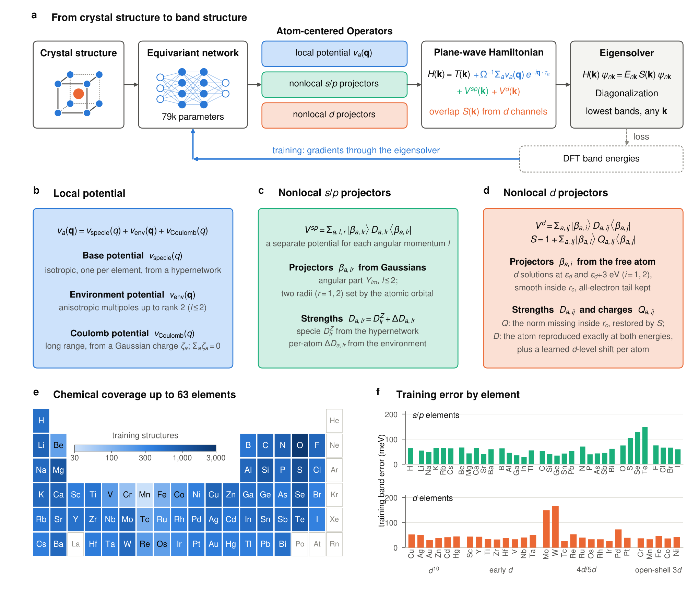

**Original caption:** **Figure 1. Design of EpNet.** **a**, An equivariant network maps element features and atomic environments to atom-centered operators, which are assembled into a plane-wave Hamiltonian *H*(**k**) and overlap *S*(**k**), followed by a diagonalization. Training propagates the error in the PBE band energies of about 12,000 Materials Project crystals through the eigensolver. **b**, Local potential: *v*_specie starts from a screened empty core (*s*/*p*) or the atom's own potential (*d*). **c**, Nonlocal *s*/*p* projectors. **d**, Nonlocal *d* projectors, built from the scalar-relativistic all-electron atom on its own local potential. **e**, The 63 elements, shaded by the number of training structures that contain each; gray, outside the scope. **f**, Training band error by element.

**中文图注：****图 1 · EpNet 的设计。** **a**，等变网络把元素特征与原子环境映射为原子中心算符，这些算符被组装成平面波哈密顿量 *H*(**k**) 与重叠矩阵 *S*(**k**)，随后做对角化。训练时，约 12,000 个 Materials Project 晶体的 PBE 能带能量误差穿过本征值求解器反向传播。**b**，局域势：*v*_specie 从屏蔽空芯（s/p）或原子自身势（d）出发。**c**，非局域 s/p 投影子。**d**，非局域 d 投影子，由标量相对论全电子原子在自身局域势上构造。**e**，63 种元素，着色深浅表示含该元素的训练结构数；灰色表示不在覆盖范围。**f**，按元素统计的训练能带误差。

**Reading note:** 这张图是全文的"骨架"。a 面板的闭环（结构 → 等变网络 → 原子中心算符 → 平面波哈密顿量 → 对角化 → 与 DFT 能带比 → 梯度回传）说明了这件工作的关键取舍：**中间层是物理对象（势、投影子），而不是一个黑箱的矩阵回归**。b–d 三个面板对应 §2 的三段代码路径：局域势（三个物理项相加）、s/p 非局域通道（Kleinman–Bylander 型高斯投影子，强度取自超网络）、d 非局域通道（从自由原子直接构造的超软赝势 + 重叠算符）。e 面板值得注意：He、Ne、Ar、Kr、Xe、La、Po、At、Rn 为灰色，说明"63 种元素"是训练集实际覆盖的并集，而非"全周期表"。f 面板中 Mo、W、S、Se、Te 的柱子明显偏高，正文 p.5 解释了这来自层状 Mo/W 二硫族化合物超胞里的大真空层，而不是这些元素本身难学。

**Source:** p.4 S015

**Original:** **Model training.** We considered a total of 12,136 PBE⁵³ band structures calculated along high-symmetry paths from the Materials Project³ for model training. The dataset comprises non-magnetic crystal structures containing up to 24 atomic sites without +*U* corrections. In total, the dataset covers 63 elements, ranging from 31 compounds containing Mn to 2,674 compounds containing O (Fig. 1e). Unlike previous approaches¹⁶, our held-out validation and test sets are defined by chemical system and structure type rather than through random splitting. Entire chemical systems (all structures sharing a given set of elements) and distinct structure types are assigned to the held-out sets via hashing prior to training. This strategy prevents polymorphs or close structural analogues of test materials from appearing in the training set, avoiding the artificially inflated predictive performance on novel chemical domains typical of random splits⁵⁴. The held-out sets are excluded from all training stages, and no held-out chemical system appears in the training split.

**中文：****模型训练。**我们总共采用 12,136 个沿高对称路径计算的 PBE⁵³ 能带结构（来自 Materials Project³）用于训练。数据集由不含 +*U* 修正、原子位点数不超过 24 的非磁性晶体结构组成。数据集共覆盖 63 种元素，含 Mn 的化合物最少（31 个），含 O 的化合物最多（2,674 个）（图 1e）。与以往做法¹⁶不同，我们的验证集与测试集按**化学体系**和**结构类型**划分，而不是随机切分。整个化学体系（共享同一组元素的所有结构）以及不同的结构类型，在训练前通过哈希被分配到留出集。这一策略避免测试材料的同质多形体或结构近亲出现在训练集中，从而避免随机切分常见的那种对新化学域预测性能的人为虚高⁵⁴。留出集在所有训练阶段都被排除，且没有任何留出化学体系出现在训练划分中。

**Source:** p.4 S016

**Original:** EpNet was trained end-to-end using 78,964 parameters according to the architecture detailed in Fig. S1. The loss function combines the band-energy error within an energy window around the band gap or Fermi level, a dedicated gap penalty, and a weakly weighted regularization term across all occupied bands. For gapped compounds featuring open-shell *d*-block elements, the loss function also incorporates target labels for the unoccupied *d* manifold. Training follows a curriculum learning strategy⁵⁵, from simpler to harder systems, with each stage initialized from the weights of the preceding one. First, *s*/*p*-block compounds are trained to establish the universal local potential. Next, small unit cells representing distinct *d*-block subgroups are introduced sequentially (*d*¹⁰ elements, early *d*-block, 4*d*/5*d* elements, and open-shell 3*d* elements). Finally, the dataset is expanded to include cells from 8 sites to 24 sites via two steps. The resulting median training errors range between 0.03 eV and 0.17 eV across the elements, as detailed in Fig. 1f.

**中文：**EpNet 按图 S1 详述的架构、以 78,964 个参数端到端训练。损失函数由三部分组成：带隙或费米能级附近能量窗口内的能带能量误差、一个专门的带隙惩罚项，以及一个权重很轻的、覆盖全部占据带的正则项。对于含开壳层 d 区元素的有隙化合物，损失函数还纳入空 d 流形的目标标签。训练遵循课程学习策略⁵⁵，由易到难，每个阶段都用前一阶段的权重初始化。首先训练 s/p 区化合物，以建立通用的局域势；随后依次引入代表不同 d 区子类的小晶胞（d¹⁰ 元素、早期 d 区、4d/5d 元素、开壳层 3d 元素）；最后分两步把数据集扩展到 8 至 24 个位点的晶胞。由此得到的逐元素训练误差中位数在 0.03 eV 到 0.17 eV 之间，详见图 1f。

---

## 3 结果（p.5–9）

**Source:** p.5 S017

**Original:** Fig. 1f. The highest training errors are predominantly concentrated in Mo, W, S, Se, and Te, originating primarily from layered mixed Mo/W dichalcogenide structures containing large vacuum gaps in the periodic supercell setup⁵⁶. Specifically, 38 of the 64 evaluated training structures containing Mo or W exhibit these elevated median errors of 0.18 eV. After excluding these layered systems, the median training errors are reduced to 0.04 eV for Mo and W, and 0.05–0.06 eV for S, Se, and Te. Hence, these errors are specific to layered stacks with large vacuum gaps rather than to Mo, W or the chalcogens in general (Supplementary Section 6).

**中文：**图 1f 中，最高的训练误差主要集中在 Mo、W、S、Se、Te，且主要来自层状混合 Mo/W 二硫族化合物结构——这些结构在周期性超胞设置中带有很大的真空层⁵⁶。具体而言，在 64 个被评测的含 Mo 或 W 的训练结构中，有 38 个表现出这种偏高的 0.18 eV 中位误差。剔除这些层状体系后，Mo 和 W 的训练误差中位数降至 0.04 eV，S、Se、Te 降至 0.05–0.06 eV。因此，这些误差是"带大真空层的层状堆叠"所特有的，而非 Mo、W 或硫族元素本身的普遍问题（补充材料第 6 节）。

**Source:** p.5 S018

**Original:** **Model evaluation across 63 elements.** Fig. 2 summarizes the performance of the final model on the 2,050 held-out structures (containing up to 24 sites) whose chemical systems were completely absent from the training set. The median band-energy error within the evaluation window is 0.061 eV, with 74% of all structures falling within an error of 0.1 eV. Representative band structures of held-out compounds, selected by error percentile ranging from the median to the 90th percentile, are presented in Fig. S2. When resolved by element (Fig. 2a), the largest errors occur on the first-row elements H, F, N, O, and C (0.09–0.11 eV). Across all held-out structures, the predicted band gaps yield a median error of 0.102 eV and a mean error of 0.16 eV (Fig. 2b), exhibiting consistent performance across diverse chemical domains. Evaluation on structure types absent from the training set and larger unit cells containing 25–60 sites shows slightly higher errors (Table S1). Overall, held-out and training errors remain closely aligned, with test-to-train error ratios ranging between 0.76 and 1.38 across the various *d*-block groups, confirming that the model avoids overfitting. Despite operating with a highly compact parameter space of 78,964 weights, EpNet achieves a good balance between low model complexity and high predictive accuracy across the periodic table.

**中文：****跨 63 种元素的模型评测。**图 2 汇总了最终模型在 2,050 个留出结构（位点数不超过 24）上的表现，这些结构所属的化学体系完全不在训练集中。评测窗口内的能带能量误差中位数为 0.061 eV，全部结构中有 74% 的误差在 0.1 eV 以内。按误差百分位（从中位数到第 90 百分位）挑选的留出化合物能带结构代表例见图 S2。按元素分解（图 2a），误差最大的是第一行元素 H、F、N、O、C（0.09–0.11 eV）。在全部留出结构上，预测带隙的中位误差为 0.102 eV、平均误差为 0.16 eV（图 2b），在不同化学域间表现一致。在训练集中不存在的结构类型、以及含 25–60 个位点的较大晶胞上评测，误差略高（表 S1）。总体上，留出误差与训练误差保持接近：各 d 区子类的测试/训练误差比在 0.76 到 1.38 之间，说明模型没有过拟合。尽管参数空间极为紧凑（仅 78,964 个权重），EpNet 在整个周期表上仍取得了模型复杂度与预测精度之间的良好平衡。

### 图 2 · 在训练中未出现过的化学体系上的精度

**Placed near:** p.5 S018
**Source:** p.6 C002

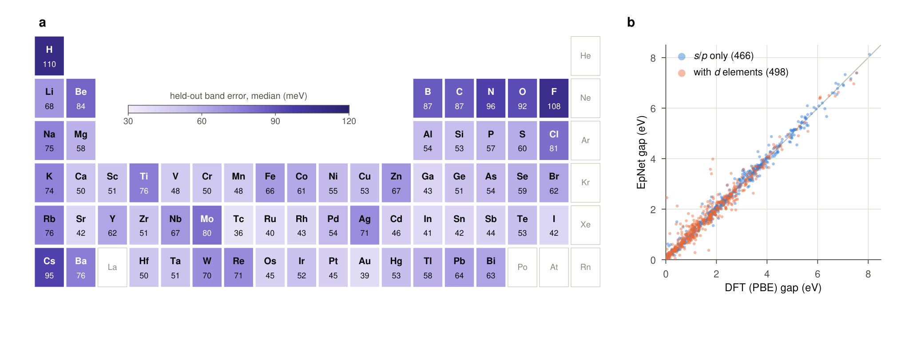

**Original caption:** **Figure 2. Accuracy on chemical systems absent from training.** **a**, Median band error (meV) of the held-out structures that contain each element. **b**, Band gaps of the 964 gapped held-out structures.

**中文图注：****图 2 · 在训练中未出现过的化学体系上的精度。** **a**，含各元素的留出结构的能带误差中位数（meV）。**b**，964 个有隙留出结构的带隙对比。

**Reading note:** 左侧元素棋盘格是"逐元素误差图"，右侧是"预测带隙 vs. PBE 带隙"的散点。两条信息合起来回答一个关键质疑：63 种元素是不是靠"少数好学的元素"把中位数拉低？答案是否定的——格子整体偏浅（多数元素 40–70 meV），深色集中在第一行（H 110、F 108、N 96、O 92、C 87），这与"2p 轨道紧致、平面波截断最吃力"的物理直觉一致。b 面板里蓝点（仅 s/p，466 个）与橙点（含 d，498 个）都紧贴对角线，说明 d 电子并没有系统性把结果拉偏；偏离主要出现在 2 eV 附近的一小簇橙点（金属/近金属被判成小带隙，或反之）。

**Source:** p.6 S019

**Original:** **Learned local potentials of s/p elements.** We attribute much of this accuracy to the constraint that the learned potentials remain physical pseudopotentials in our design. Fig. 3a shows that the base potentials of the *s*/*p* elements stay smooth, finite at *q* = 0 as for screened ions and decaying by 8 Å⁻¹, and differ from the empty cores they started from mainly below 3 Å⁻¹. The first node of a base potential is the wavevector at which *v*_specie(*q*) first changes sign, from attractive to repulsive, measuring the size of the ion core. For an empty core of radius r_c, it lies at *q* = π/(2r_c). Across all 34 *s*/*p* elements, the learned first node follows that of the starting empty core, with a Pearson correlation coefficient *r* = 0.91 (Fig. 3b). Beyond these base potentials, the chemistry-specific part of the model lies in the environment potential and the charges. The learned environment potential also follows bonding (see Fig. 3c). For carbon its spherical part shifts the potential near *q* = 1 Å⁻¹ by about ±11 eV·Å³, a tenth of the base potential there (−123 eV·Å³), in opposite directions for twofold and fourfold coordination. Its anisotropic part is 1.6–1.8 eV·Å³ for twofold and threefold carbon but almost vanishes (0.13 eV·Å³) for fourfold carbon, as it should for tetrahedral sites, whose symmetry forbids dipole and quadrupole terms. Fig. 3d shows the learned atomic charges ζ_a of the held-out *s*/*p* compounds against their electronegativity relative to the cell mean. Their median magnitude is 0.10 *e*, far below formal oxidation states, yet they correlate strongly with the atom's electronegativity (*r* = −0.91). Switching them off in the trained model shows that on 240 ionic held-out *s*/*p* structures the median band error rises from 0.063 to 0.152 eV, 77% of the structures become worse by more than 0.01 eV, and the median gap error of the 167 gapped ones rises from 0.077 to 0.393 eV. In the meantime, the metals change less (0.044 to 0.091 eV). This confirms that the charges are essential for ionic compounds, and that the model has learned to use them correctly.

**中文：****s/p 元素学到的局域势。**我们把这种精度在很大程度上归因于一项设计约束：学到的势始终保持为**物理上的赝势**。图 3a 显示，s/p 元素的基础势保持平滑，在 *q* = 0 处有限（与屏蔽离子一致），并在 8 Å⁻¹ 之前衰减；它与出发时的空芯势的差别主要出现在 3 Å⁻¹ 以下。基础势的第一个节点是 *v*_specie(*q*) 首次变号（由吸引变为排斥）的波矢，可用来度量离子芯的尺寸。对半径为 r_c 的空芯，它位于 *q* = π/(2r_c)。在全部 34 种 s/p 元素上，学到的第一节点都跟随出发时空芯的第一节点，Pearson 相关系数 *r* = 0.91（图 3b）。除基础势之外，模型中"化学特异性"的部分落在环境势与电荷上。学到的环境势同样跟随成键环境（图 3c）。以碳为例，其球对称部分使 *q* = 1 Å⁻¹ 附近的势移动约 ±11 eV·Å³，是该处基础势（−123 eV·Å³）的十分之一，且在二配位与四配位下方向相反。其各向异性部分对二配位和三配位碳为 1.6–1.8 eV·Å³，而对四配位碳几乎消失（0.13 eV·Å³）——这正是四面体位点应有的行为，因为其对称性禁止偶极项与四极项。图 3d 给出留出 s/p 化合物的原子电荷 ζ_a 对其相对晶胞平均电负性的关系：电荷量级的中位数为 0.10 *e*，远低于形式氧化态，却与原子电负性强相关（*r* = −0.91）。在训练好的模型中把这些电荷关掉后：在 240 个离子性留出 s/p 结构上，能带误差中位数从 0.063 eV 升至 0.152 eV，77% 的结构变差超过 0.01 eV；其中 167 个有隙结构的带隙误差中位数从 0.077 eV 升至 0.393 eV。与此同时金属变化较小（0.044 → 0.091 eV）。这证实电荷对离子化合物必不可少，且模型已学会正确使用它们。

### 图 3 · s/p 元素学到的局域势

**Placed near:** p.6 S019
**Source:** p.7 C003

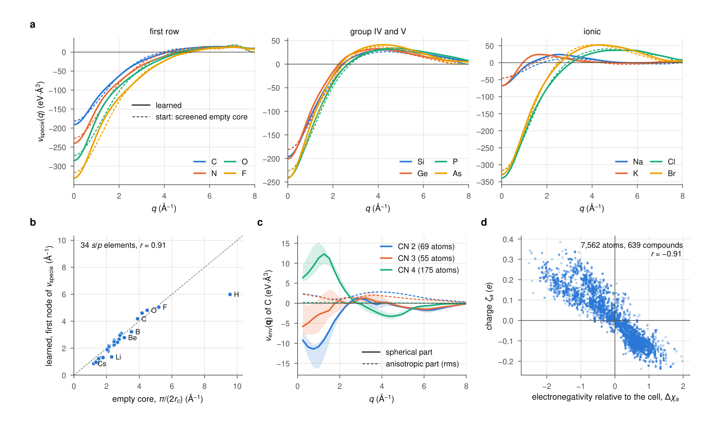

**Original caption:** **Figure 3. Learned local potentials of *s*/*p* elements.** **a**, Base potentials *v*_specie(*q*) of first-row, group IV and V and ionic elements (solid) and the screened empty cores they started from (dashed). **b**, First node of *v*_specie against that of the empty core, π/(2r_c) with r_c = 0.53r_cov, for the 34 *s*/*p* elements. **c**, Environment potential of the carbon atoms of scored *s*/*p* compounds, by coordination number: spherical part (median, solid; interquartile range, shading) and anisotropic part (root mean square over directions, dashed). **d**, Charges ζ_a of the atoms of the held-out *s*/*p* compounds against their electronegativity relative to the cell mean.

**中文图注：****图 3 · s/p 元素学到的局域势。** **a**，第一行元素、第 IV/V 族元素与离子性元素的基础势 *v*_specie(*q*)（实线）及其出发时的屏蔽空芯（虚线）。**b**，34 种 s/p 元素的 *v*_specie 第一节点对空芯的 π/(2r_c)（r_c = 0.53 r_cov）作图。**c**，已评分 s/p 化合物中碳原子的环境势，按配位数分组：球对称部分（中位数，实线；四分位区间，阴影）与各向异性部分（各方向均方根，虚线）。**d**，留出 s/p 化合物中原子电荷 ζ_a 对其相对晶胞平均电负性作图。

**Reading note:** 这是全文最"物理"的一张图，用意是回答"网络究竟学到了什么"。三个检验各自对应一个本应成立的物理事实。(1) 赝势的节点位置与离子芯半径成反比——学出来的 *r* = 0.91，说明模型没有把*基础势*当成可以随便扭曲的拟合参数。(2) 四配位碳的多极项必须趋于零（T_d 对称性）——实测 0.13 vs. 三配位 1.8 eV·Å³，说明等变编码器确实按对称性约束输出。(3) 电荷与电负性反相关（*r* = −0.91）且量级 0.10 e——说明它学到的是"有效电荷"而非法拉第氧化态。第 (3) 点还配了一个**消融实验**（把电荷置零），这是全文最有说服力的因果证据：离子化合物误差翻倍，金属几乎不变，正好对应"电荷项只在离子体系里起作用"的物理预期。

**Source:** p.7 S020

**Original:** **Learned potentials of *d* elements.** For the *d* elements, the essential physics is built in before any learning. The width of a *d* band is set by the overlap of *d* orbitals on neighboring atoms, which lies in the orbital tail (Fig. 4a). EpNet therefore builds each *d* channel from the free atom's *d* orbital and keeps its all-electron tail unchanged; the norm missing inside the core radius is restored by the overlap operator, and the channel has no spurious bound states⁵⁷. Before any training, this construction places the *d*-band widths of seven *d*¹⁰ compounds within 1.13–1.26 times PBE (Supplementary S3, Fig. S3 and Table S2). After model training, the corrections learned on top of this construction are small, and most of them follow physical trends. The base potentials stay within 0.2% (root mean square) of their atomic tables, and the orbital stretch within 1% of the atomic orbital. The learned *d*-level shifts (Fig. 4b) are a few tenths of an eV, the size of the correction between a free neutral atom and a *d* ion screened in a crystal. They sort by shell filling. Per element, they are slightly negative for the filled *d*¹⁰ shells (median −0.13 eV) and positive for the open-shell 3*d* and the 4*d*/5*d* elements (medians +0.17 and +0.16 eV). Per atom, they are largest on the most cationic sites.

**中文：****d 元素学到的势。**对 d 元素而言，关键物理在**任何学习之前**就已内建。d 带的宽度由相邻原子 d 轨道之间的重叠决定，而这一重叠位于轨道尾部（图 4a）。因此 EpNet 用自由原子的 d 轨道构造每个 d 通道，并保持其全电子尾部不变；芯半径以内缺失的模由重叠算符恢复，通道不含虚假束缚态⁵⁷。在尚未做任何训练时，这一构造就把七个 d¹⁰ 化合物的 d 带宽放在 PBE 的 1.13–1.26 倍以内（补充材料 S3、图 S3 与表 S2）。模型训练之后，叠加在这一构造之上的学习修正很小，且大多遵循物理趋势：基础势与原子表的偏离在 0.2%（均方根）以内，轨道伸缩在原子轨道的 1% 以内。学到的 d 能级平移（图 4b）只有零点几 eV，正是"自由中性原子"与"晶体中被屏蔽的 d 离子"之间的修正量级。它们按壳层填充排序：按元素，满壳 d¹⁰ 略为负（中位数 −0.13 eV），开壳层 3d 与 4d/5d 为正（中位数 +0.17 与 +0.16 eV）；按原子，在最阳离子化的位点上最大。

**Source:** p.7–8 S021

**Original:** The environment potential (Fig. 4c) is more repulsive at more crowded sites, as the overlap of neighboring charge densities makes it: its spherical part near *q* = 1 Å⁻¹ rises from 11 eV·Å³ at fourfold sites to 20–23, 29 and 37 eV·Å³ at six-, eight- and twelvefold sites. Its anisotropic part obeys the crystal-field selection rules: it is small at tetrahedral and octahedral sites (0.9–1.1 eV·Å³), whose cubic symmetry forbids dipole and quadrupole terms, and larger at trigonal prisms (1.6 eV·Å³), where a quadrupole term splits *d*_z² from the in-plane *d*_xy and *d*_x²−y² orbitals. However, the charges of the *d* atoms are not physical (Fig. 4d): 85% of those in held-out compounds are negative (median −0.12*e*), and they correlate only weakly with electronegativity (*r* = −0.25, against −0.91 for *s*/*p* atoms). A negative charge raises the potential of the atom, and the model appears to use it, with the mostly positive *d*-level shifts, to lift a *d* level that sits too deep; constraining the charges to be non-negative lost the fit of the *d* gaps, so we read them as effective parameters.

**中文：**环境势（图 4c）在位点越拥挤时越偏排斥——这是相邻电荷密度重叠的必然结果：其球对称部分在 *q* = 1 Å⁻¹ 附近从四配位的 11 eV·Å³ 升至六配位、八配位、十二配位的 20–23、29 与 37 eV·Å³。其各向异性部分服从晶体场选择定则：在四面体与八面体位点上很小（0.9–1.1 eV·Å³，因为立方对称性禁止偶极项与四极项），而在三方柱位点上较大（1.6 eV·Å³，此处四极项把 *d*_z² 与面内的 *d*_xy、*d*_x²−y² 劈裂开）。不过，d 原子的电荷并不是物理量（图 4d）：留出化合物中 85% 的 d 原子电荷为负（中位数 −0.12*e*），且与电负性只有弱相关（*r* = −0.25；s/p 原子为 −0.91）。负电荷会抬高原子处的势，模型似乎正是利用这一点，配合大多为正的 d 能级平移，把一个"位置过深"的 d 能级抬起来；把电荷约束为非负会失去对 d 带隙的拟合，因此我们把这些电荷解读为**有效参数**。

### 图 4 · d 元素学到的势与 d 通道

**Placed near:** p.7 S020–S021
**Source:** p.8 C004

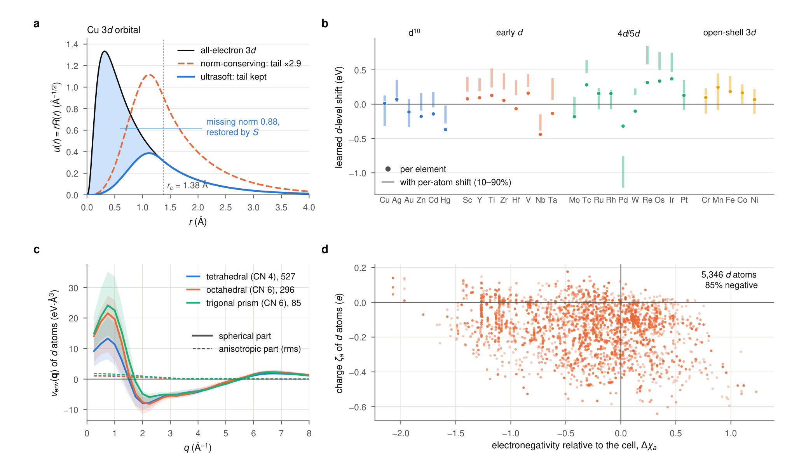

**Original caption:** **Figure 4. Learned potentials and *d* channels of *d* elements.** **a**, Cu 3*d* orbital: all-electron (black), the ultrasoft pseudo-orbital that keeps the all-electron tail (blue) and a norm-conserving pseudo-orbital obtained by renormalizing it (orange); shading: the norm restored by the overlap operator. **b**, Learned *d*-level shifts: per element (dots) and, with the per-atom shift, the 10th–90th percentiles over the *d* atoms of the scored compounds (bars). **c**, Environment potential of *d* atoms by coordination: spherical part (median, solid; interquartile range, shading) and anisotropic part (root mean square over directions, dashed). **d**, Charges of the *d* atoms of held-out compounds against their electronegativity relative to the cell mean.

**中文图注：****图 4 · d 元素学到的势与 d 通道。** **a**，Cu 的 3d 轨道：全电子（黑）、保持全电子尾部的超软赝轨道（蓝）、以及将其重新归一化后得到的模守恒赝轨道（橙）；阴影表示由重叠算符恢复的模。**b**，学到的 d 能级平移：按元素（点）以及叠加逐原子平移后，在已评分化合物的 d 原子上取的 10–90 百分位区间（柱）。**c**，d 原子的环境势，按配位分组：球对称部分（中位数，实线；四分位区间，阴影）与各向异性部分（各方向均方根，虚线）。**d**，留出化合物中 d 原子电荷对其相对晶胞平均电负性作图。

**Reading note:** a 面板是整篇论文方法论的"最小可判据"：如果对赝轨道做常规的模守恒重归一化（橙线），尾部会被放大 2.9 倍，d 带宽度随之爆炸；如果保留全电子尾部、把缺失的模交给重叠算符 S 处理（蓝线），d–d 重叠就回到物理量级。作者在补充材料 S3 里把这件事量化了：重归一化方案的 d 带宽度是 PBE 的 3.7–10.6 倍，而"保留尾部 + 重叠算符 + 原子自身局域势 + 第二个参考能量"四件套齐全后是 1.13–1.26 倍。d 面板则是全文**唯一一处明确承认"不物理"**的地方：85% 的 d 原子电荷为负、与电负性几乎不相关，作者选择如实说明并把它解读为有效参数，而不是强行解释成物理电荷。

**Source:** p.8 S022

**Original:** **Application to large-scale materials screening.** We next apply EpNet to the large-scale Alexandria PBE database⁹, from which we extracted 600,617 non-magnetic structures that are completely absent from the Materials Project, span the 63 *s*/*p*/*d* elements, contain up to 24 sites and lie within 0.1 eV/atom of the convex hull. Since Alexandria gives band gaps but not band structures, EpNet scored all of them based on the gap values and the metal/insulator classification. For a fair comparison with other methods, we also drew a sample of 5,000, 1,000 per group to score tight-binding models below.

**中文：****用于大规模材料筛选。**接下来我们把 EpNet 应用于大规模 Alexandria PBE 数据库⁹，从中提取出 600,617 个非磁性结构：它们完全不在 Materials Project 中、覆盖 63 种 s/p/d 元素、位点数不超过 24、且位于凸包以上 0.1 eV/atom 以内。由于 Alexandria 只提供带隙而不提供能带结构，EpNet 依据带隙值与金属/绝缘体分类对全部结构打分。为与其他方法公平比较，我们还抽取了 5,000 个结构的样本（每组 1,000 个），用于给下文中的紧束缚模型打分。

**Source:** p.8–9 S023

**Original:** Fig. 5a shows that over all 600,617 structures EpNet's median gap error is 0.108 eV over the 124,416 gapped ones, 98.9% are correctly classified as metal or insulator, and the distribution of gaps matches Alexandria's. On structures present in both databases, the Alexandria and Materials Project gaps differ by a median of only 0.03 eV, so Alexandria is a fair external test for a model trained on Materials Project labels. Fig. 5b,c compares EpNet with existing models on the same structures. Two graph networks trained on Materials Project PBE gaps, ALIGNN¹⁴ and MEGNet¹³, are fast to run on the whole pool, but they only yield the scalar gap values and their median gap errors are 0.279 and 0.555 eV, 1.8–3.0 and 3.1–5.7 times EpNet's in the five groups, and they classify many metals as insulators (89% and 88%, against 99% for EpNet). Two tight-binding models also return full band structures. On the 5,000-structure sample their median gap errors are 0.282 eV (DFTB⁺⁵⁸ with the PTBP parameters²⁹), against 0.105 eV for EpNet on the same structures, and 0.424 eV (ThreeBodyTB³⁰, on the 1,597 structures within its fit), against 0.091 eV. Hence, EpNet is the most accurate model in every group.

**中文：**图 5a 显示，在全部 600,617 个结构上，EpNet 在 124,416 个有隙结构上的带隙误差中位数为 0.108 eV，98.9% 的结构被正确分类为金属或绝缘体，且带隙分布与 Alexandria 一致。在两个数据库都收录的结构上，Alexandria 与 Materials Project 的带隙中位数仅差 0.03 eV，因此 Alexandria 对"用 Materials Project 标签训练的模型"来说是一个公平的外部测试。图 5b,c 在同一批结构上比较 EpNet 与现有模型。两个在 Materials Project PBE 带隙上训练的图网络 ALIGNN¹⁴ 与 MEGNet¹³ 能在整个池子上快速运行，但它们只给出标量带隙值，带隙误差中位数分别为 0.279 与 0.555 eV，在五个分组中是 EpNet 的 1.8–3.0 倍与 3.1–5.7 倍；且它们把许多金属判成绝缘体（正确率 89% 与 88%，EpNet 为 99%）。两个紧束缚模型也能给出完整能带结构：在 5,000 结构样本上，其带隙误差中位数为 0.282 eV（DFTB⁺⁵⁸ 配 PTBP 参数²⁹），而 EpNet 在同一批结构上为 0.105 eV；ThreeBodyTB³⁰ 为 0.424 eV（在其拟合范围内的 1,597 个结构上），EpNet 为 0.091 eV。因此，EpNet 在每一个分组中都是最准确的模型。

**Source:** p.9 S024

**Original:** In addition to its predictive accuracy, EpNet is compelling due to its low computational cost (Fig. 5c). For gapped systems, EpNet requires approximately 12 s per structure on 8 CPU cores, compared to 4 s and 12 s for tight-binding models on identical CPU hardware, and roughly 0.1 s for graph neural networks, which yield only the band gap. However, GPU acceleration significantly reduces this runtime. Using EpNet, screening 614,729 structures of the Alexandria database required 18.5 h across 16 GPUs, a median of 0.9 s per structure on a single GPU. We further benchmarked EpNet's computational cost against standard DFT solvers using two distinct test sets (Figs. S4 and S5). On 24 held-out structures containing 2–24 atoms, computing a converged PBE band structure using Quantum ESPRESSO⁵⁹˒⁶⁰ with SSSP pseudopotentials⁶¹ required 3–984 s. This corresponds to a median wall-clock time 99 times longer than EpNet on a single GPU, and 12 times longer than EpNet on the same 16 CPU cores (Fig. S4). The speedup grows with cell size up to 24 atoms (Fig. S4); for larger cells it becomes a constant factor, as both codes scale as *N*^2.2–*N*^2.6 (Fig. S5). On FCC supercells of Al and Cu containing more than 64 atoms, EpNet on a single GPU is 110–200 times faster for Al and 420–470 times faster for Cu per k-point than Quantum ESPRESSO on 16 CPU cores, requiring only 10 s and 82 s per k-point for 512-atom supercells of Al and Cu, respectively.

**中文：**除预测精度外，EpNet 还因计算代价低而具吸引力（图 5c）。对有隙体系，EpNet 在 8 个 CPU 核心上约需 12 s/结构；在相同 CPU 硬件上，紧束缚模型为 4 s 与 12 s，而只给出带隙的图神经网络约需 0.1 s。不过，GPU 加速可显著缩短该时间：用 EpNet 筛选 Alexandria 数据库的 614,729 个结构，在 16 块 GPU 上共需 18.5 h，单块 GPU 上每结构中位耗时 0.9 s。我们还用两个不同的测试集，把 EpNet 的计算代价与标准 DFT 求解器做了基准比较（图 S4、S5）。在 24 个含 2–24 个原子的留出结构上，用 Quantum ESPRESSO⁵⁹˒⁶⁰ 配 SSSP 赝势⁶¹ 计算一个收敛的 PBE 能带结构需要 3–984 s。这相当于墙钟时间中位数比单块 GPU 上的 EpNet 长 99 倍、比同样 16 个 CPU 核心上的 EpNet 长 12 倍（图 S4）。加速比随晶胞增大到 24 原子而增长（图 S4）；对更大的晶胞则变为一个常数因子，因为两种代码的标度都是 *N*^2.2–*N*^2.6（图 S5）。在含 64 个原子以上的 Al 与 Cu 面心立方超胞上，单块 GPU 的 EpNet 按每个 k 点计，对 Al 快 110–200 倍、对 Cu 快 420–470 倍（对比 16 核上的 Quantum ESPRESSO）；对 512 原子的 Al 与 Cu 超胞，每 k 点仅需 10 s 与 82 s。

**Source:** p.9 S025

**Original:** EpNet's efficiency stems from bypassing the self-consistent field cycle, employing a significantly smaller plane-wave basis set (a 12–20 Ry kinetic energy cutoff compared to 35–90 Ry in standard DFT), and leveraging full GPU parallelization. Table S3 also provides a detailed comparison of EpNet against several other machine-learning and semi-empirical electronic structure methods.

**中文：**EpNet 的高效来自三点：绕开自洽场循环；采用小得多的平面波基组（动能截断 12–20 Ry，而标准 DFT 为 35–90 Ry）；以及充分利用 GPU 并行。表 S3 还给出了 EpNet 与若干其他机器学习及半经验电子结构方法的详细对比。

### 图 5 · 在未见过的 Alexandria 材料上基准测试并与其他模型比较

**Placed near:** p.8 S022–p.9 S024
**Source:** p.10 C005

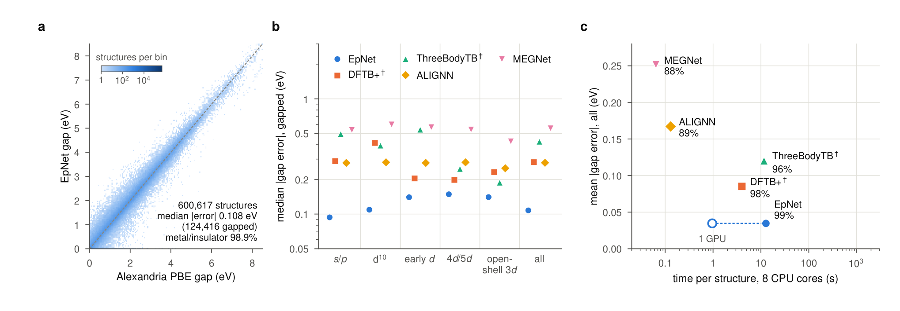

**Original caption:** **Figure 5. Benchmarking unseen Alexandria materials and comparison with other models.** Alexandria structures absent from the Materials Project: all 600,617 in **a**; in **b** and **c**, all of them for EpNet, ALIGNN and MEGNet and the 5,000 test structures for the two tight-binding models marked with † (ThreeBodyTB on the 1,597 within its fit). **a**, EpNet (screening mode) against Alexandria band gaps, structures per bin. **b**, Median gap error of the gapped structures, by group. **c**, Mean gap error over all structures against time per structure on 8 CPU cores; labels, metal/insulator agreement; open marker, EpNet on one GPU.

**中文图注：****图 5 · 在未见过的 Alexandria 材料上基准测试并与其他模型比较。** 均为不在 Materials Project 中的 Alexandria 结构：**a** 用全部 600,617 个；**b**、**c** 中 EpNet、ALIGNN、MEGNet 用全部结构，两个带 † 的紧束缚模型用 5,000 个测试结构（ThreeBodyTB 用其拟合范围内的 1,597 个）。**a**，EpNet（筛选模式）对 Alexandria 带隙，颜色深浅表示每个区间的结构数。**b**，有隙结构的带隙误差中位数，按分组。**c**，全部结构上的平均带隙误差对 8 CPU 核心下每结构耗时；标签为金属/绝缘体判对率；空心标记为单块 GPU 上的 EpNet。

**Reading note:** 这张图承担了论文的"第三方验收"。要点有三。第一，a 面板的 60 万点云贴在对角线上，中位误差 0.108 eV，且金属/绝缘体判对率 98.9%——注意这个判对率比 ALIGNN/MEGNet 的 89%/88% 更重要，因为筛选中把金属误判成有隙会直接浪费后续资源。第二，b 面板按 d 区子类分组，EpNet 在**每一组**都是最好的（这正是"跨周期表"主张的实证）。第三，c 面板是"精度–代价"平面：ALIGNN/MEGNet 在左侧（0.1 s 级）但误差高一个量级；DFTB⁺/ThreeBodyTB 与 EpNet 同在 10 s 级，但误差是 2–4 倍；单块 GPU 的 EpNet（空心标记）把代价压到 1 s 以下而精度不变——这是"约 1% DFT 代价"说法的来源。

---

## 4 结论（p.9–10）

**Source:** p.9 S026

**Original:** We have demonstrated that a physics-based empirical pseudopotential network with 78,964 parameters captures the electronic band structures of crystals across the *s*, *p*, and *d* blocks of the periodic table. The central innovation is a Hamiltonian decomposed into distinct local and nonlocal operators. In this design, a universal local potential for all elements is learned from atomic features and local structural environments, while the nonlocal channels use learned projectors for the extended *s* and *p* states and projectors built from the free atom for the localized *d* states. On chemical systems absent from the training set, EpNet, without self-consistent iterations or reliance on a DFT solver, predicts complete band structures directly from crystal coordinates with median errors of 0.061 eV for band energies and 0.102 eV for band gaps. Crucially, benchmarks on an independent database show band-gap errors 2–5 times smaller than those of direct property-prediction networks and tight-binding models.

**中文：**我们已证明：一个基于物理、含 78,964 个参数的经验赝势网络，能够刻画跨越周期表 s、p、d 区晶体的电子能带结构。核心创新在于把哈密顿量分解为彼此不同的局域算符与非局域算符。在这一设计中，面向所有元素的通用局域势由原子特征与局域结构环境学得；非局域通道对延展的 s、p 态使用学习到的投影子，对局域的 d 态则使用由自由原子构造的投影子。在训练集中不存在的化学体系上，EpNet 无需自洽迭代、也不依赖 DFT 求解器，就能直接从晶体坐标预测完整能带结构，能带能量与带隙的中位误差为 0.061 eV 与 0.102 eV。关键在于，在独立数据库上的基准显示，其带隙误差比直接性质预测网络与紧束缚模型小 2–5 倍。

**Source:** p.9 S027

**Original:** The remaining errors are concentrated within a few specific chemical regimes (Supplementary Section 6 and Fig. S6). Furthermore, the model currently inherits the domain limits of its training labels. The present model is limited to PBE band energies of non-magnetic crystals without spin–orbit coupling. However, because EpNet relies solely on band energies for training, it can be readily extended or fine-tuned on hybrid-functional²⁶˒⁶², *GW*³⁸˒⁶³, or experimental³⁵ band data without requiring full Hamiltonian matrices. Looking forward, *f*-block elements can be incorporated using the same atomic construction established for *d* channels, and the underlying Hamiltonian formulation can be extended to enable application to absolute band alignment and electron–phonon coupling calculations³⁸˒⁶⁴⁻⁶⁷.

**中文：**剩余的误差集中在少数几个特定的化学区间（补充材料第 6 节与图 S6）。此外，模型目前继承了其训练标签的适用域限制：现有模型局限于无磁性、无自旋–轨道耦合晶体的 PBE 能带能量。但由于 EpNet 训练只依赖能带能量，它可以很容易地扩展到杂化泛函²⁶˒⁶²、*GW*³⁸˒⁶³ 或实验³⁵ 能带数据上，或在其中微调，而不需要完整的哈密顿量矩阵。展望未来，f 区元素可以沿用为 d 通道建立的同一套原子构造纳入模型；底层的哈密顿量表述也可推广，以用于绝对能带对齐与电子–声子耦合计算³⁸˒⁶⁴⁻⁶⁷。

---

## 5 Methods（方法细节，p.10–14）

> 说明：本节是论文的正式 Methods，页码接在正文之后（p.10–14 的右半部分起）。参考文献 [1]–[79] 见 p.14–20，本读者不再逐条翻译，仅保留编号以便与原文对照。

**Source:** p.10 S028

**Original:** **Hamiltonian and basis.** The basis is centered on each k, |**k** + **G**| ≤ g_c, and k is folded into the first Brillouin zone before *H*(**k**) is built³⁹. The kinetic-energy cutoff depends on the element, 12 Ry by default. Compact 2p states need more plane waves than heavier p states, so we used 16 Ry for B and C and 20 Ry for N, O, F and all *d* elements. Like other plane-wave codes, each cell uses the largest cutoff of its elements. In the first stage of training, on the *s*/*p* compounds, a basis-consistency term, the mean absolute difference of the bands at four k points between the cell's cutoff and 20 Ry after removing a rigid shift, was added to the loss with weight 1 for one cell per GPU and step, so that the learned potential does not exploit the truncation of the basis. The **G** = 0 component of the local potential is set to zero, which fixes the energy reference. Band energies are therefore compared after alignment. For cells with *d* atoms the generalized problem *H***c** = *E*·*S***c** is solved through the Cholesky factor of *S* on the dense path, and through the exact low-rank *S*^{−1/2} (Löwdin form⁶⁸) on the iterative path.

**中文：****哈密顿量与基组。**基组以每个 k 点为中心，|**k** + **G**| ≤ g_c；在构建 *H*(**k**) 之前，k 被折叠进第一布里渊区³⁹。动能截断依元素而定，默认 12 Ry。紧致的 2p 态比重元素的 p 态需要更多平面波，因此 B、C 用 16 Ry，N、O、F 与全部 d 元素用 20 Ry。与其他平面波代码一样，每个晶胞采用其组成元素中最大的截断。在训练第一阶段（s/p 化合物）中，损失里额外加入一个**基组一致性项**：在四个 k 点上，比较晶胞自身截断与 20 Ry 截断下的能带（先扣除一个刚性平移），取平均绝对差；每个 GPU、每个 step 抽取一个晶胞，权重为 1——这样学到的势就不会去"利用"基组截断。局域势的 **G** = 0 分量置零，以固定能量参考；因此能带能量在对齐之后再比较。对含 d 原子的晶胞，广义本征值问题 *H***c** = *E*·*S***c** 在稠密路径上通过 *S* 的 Cholesky 因子求解，在迭代路径上则通过精确的低秩 *S*^{−1/2}（Löwdin 形式⁶⁸）求解。

**Source:** p.10 S029

**Original:** **Specie potentials / Base potentials.** Each element is described by 15 features: a constant, Z/100, period/7, group/18, the s, p and d valence occupancies, one-hot s, p and d block labels, the Pauling electronegativity χ/4, the covalent radius⁶⁹/2.5 Å, Z²/10⁴, the model valence Z_m/12 and the number of model d electrons, which separates valence d shells (Zn–Hg) from the filled semicore shells of Ga–Bi. A hypernetwork, a multilayer perceptron with one hidden layer of 32 units with sigmoid linear unit (SiLU) activations, maps these features to the specie projector strengths and to the coefficients of the specie potential,

$$v_{\mathrm{specie}}(q) = \sum_{n=0}^{11}c^{Z}_{n}\phi_n(q;8) + \sum_{n=0}^{25}t^{Z}_{n}\phi_n(q;17),\qquad \phi_n(q;q_c) = \tfrac{1}{2}(1+\cos\pi x)\cos n\pi x,\quad x=\min(q/q_c,1), \tag{4}$$

**中文：**式 (4) 是种类势的余弦基展开：n = 0…11 的主项覆盖到 8 Å⁻¹，n = 0…25 的高 q 尾部覆盖到 17 Å⁻¹；窗函数 ½(1+cos πx) 保证在 q = q_c 处平滑截断。

**Source:** p.11 S030

**Original:** with q_c in Å⁻¹. The second sum, a high-q tail, is needed because the 20 Ry basis couples plane waves up to |Δ**G**| ≈ 17 Å⁻¹. The coefficients are the sum of the hypernetwork output, a small per-element residual with an L2 penalty (3×10⁻⁶) and a fixed prior. For s/p elements, the prior is a Thomas–Fermi-screened Ashcroft empty-core pseudopotential⁴⁸. It is set by the element's valence Z_m and its core radius r_c = 0.53r_cov, a fixed multiple of the covalent radius r_cov, since pseudopotential core radii scale linearly with atomic radii⁷⁰. Because the prior depends only on element features, it is defined for every element. For d elements it is the tabulated all-electron local potential described below, and the learned deviation from it enters scaled by 0.01. The hypernetwork's output layer and the residuals start at zero.

**中文：**其中 q_c 的单位为 Å⁻¹。第二个求和是"高 q 尾部"，因为 20 Ry 基组会把平面波耦合到 |Δ**G**| ≈ 17 Å⁻¹。系数由三部分相加：超网络输出、带 L2 惩罚（3×10⁻⁶）的逐元素小幅残差，以及一个固定的**先验**。对 s/p 元素，先验是 Thomas–Fermi 屏蔽的 Ashcroft 空芯赝势⁴⁸，由元素的价电子数 Z_m 与芯半径 r_c = 0.53r_cov 设定——r_c 是共价半径的固定倍数，因为赝势芯半径与原子半径呈线性标度⁷⁰。由于先验只依赖元素特征，它对每个元素都有定义。对 d 元素，先验是下文列出的全电子局域势表，学到的偏离以 0.01 的比例系数进入。超网络的输出层与各残差都从零开始。

**Source:** p.11 S031

**Original:** **Environment terms and charges.** We extended the environment encoder from the previous EpNet-Si³⁹ to many species, using neighbor moments up to *l* = 2 within 6 Å under periodic boundary conditions, 8 radial functions, a single gated pass, and 64 channels of invariant (h_a), vector (**d**_a) and traceless rank-2 (Q_a) features. The species embedding is a learned linear map of the element features plus a penalized per-species residual (L2 weight 10⁻³), so an element enters through its features rather than through an independent vector. The norms of **d**_a and Q_a that feed the gates are smoothed as s(√(1 + |x|²/s²) − 1) with s = 0.05, which removes the cusp of |x| at high-symmetry sites, where **d**_a = Q_a = 0, and keeps second derivatives of the bands with respect to atomic displacements well defined. Four readouts map the encoder features to form factors with *l* = 0,1,2 components and the (−i)^l phases that keep *V*(−**G**) = *V*(**G**)*, with an additional 12-term cosine basis in the monopole channel. A router mixes them with per-atom softmax weights π_a,ν from a multilayer perceptron (one hidden layer of 16 units) on eight standardized inputs: the logarithm of the local valence-electron density n_v(r) = Σ_j Z_{m,j} w(r_aj;r)/(4/3·πr³) at r = 2, 3, 4, 5, 6, 8 and 10 Å, normalized by 0.2 *e*/ų, where w is a smooth neighbor count, and the mean electronegativity difference to the neighbors within 4 Å. A linear head on the invariant features gives raw charges whose cell mean is subtracted, so that Σ_a ζ_a = 0 holds exactly, while the charges enter only through the Coulomb potential *v*_Coulomb of equation (2) (σ = 0.5 Å), and the head starts at zero.

**中文：****环境项与电荷。**我们把此前 EpNet-Si³⁹ 的环境编码器扩展到多元素：在周期边界条件下、6 Å 范围内使用至 *l* = 2 的邻原子矩，8 个径向函数，一次门控（gated）传递，以及 64 个通道的不变量（h_a）、矢量（**d**_a）与无迹秩 2 张量（Q_a）特征。种类嵌入是元素特征的一个学习到的线性映射，另加带惩罚的逐种类残差（L2 权重 10⁻³），因此元素是通过其特征进入网络，而不是通过一个独立向量。送入门控的 **d**_a 与 Q_a 的模长按 s(√(1+|x|²/s²) − 1)、s = 0.05 做平滑：这消除了 **d**_a = Q_a = 0 的高对称位点上 |x| 的尖点，并保证能带对原子位移的二阶导数有良好定义。四个读出把编码器特征映射为形状因子，含 *l* = 0、1、2 分量，并带 (−i)^l 相位以保持 *V*(−**G**) = *V*(**G**)*；单极通道中另加 12 项余弦基。一个路由器用逐原子 softmax 权重 π_a,ν 混合这些读出，权重来自一个多层感知机（单隐层 16 单元），输入为八个标准化量：局域价电子密度 n_v(r) = Σ_j Z_{m,j} w(r_aj;r)/(4/3·πr³) 在 r = 2、3、4、5、6、8、10 Å 处的对数（以 0.2 *e*/ų 归一化，w 为光滑邻原子计数），以及 4 Å 内邻原子的平均电负性差。不变量特征上的一个线性头给出原始电荷，再减去晶胞平均值，从而严格满足 Σ_a ζ_a = 0；电荷只通过式 (2) 的库仑势 *v*_Coulomb（σ = 0.5 Å）起作用，且该线性头从零开始。

**Source:** p.11 S032

**Original:** **Nonlocal projectors / s/p elements.** The nonlocal term of equation (1) is *V*^nl = *V*^sp + *V*^d, and the first term is

$$V^{sp}_{GG'}(\mathbf{k}) = \sum_{a\in sp}\ \sum_{l\le l_{\max}(Z_a)}\ \sum_{r=1}^{2}\bigl(D^{Z_a}_{lr} + \Delta D_{a,lr}\bigr)\sum_{m}\beta^{lm}_{ar}(\mathbf{p})\,\beta^{lm*}_{ar}(\mathbf{p}'), \tag{5}$$

**中文：**式 (5) 是 s/p 的非局域项：对每个 s/p 原子、每个角动量通道 *l*（至 *l*_max(Z_a)）、每个径向函数 *r* = 1, 2 求和；强度是元素种类强度 D^Z_lr 加逐原子修正 ΔD_a,lr，角向部分由球谐 *m* 求和给出。

**Source:** p.12 S033

**Original:** with **p** = **k** + **G**, **p**′ = **k** + **G**′ and Gaussian radial projectors carrying the angular factor of channel *l*⁴⁹. The two radial functions of channel *l* have real-space radii of 1.2 and 0.7 times r_l, the peak radius of the element's valence s or p orbital in the neutral all-electron atom computed in the local-density approximation (LDA)⁷¹, multiplied by a learned global factor per radial function and a learned factor per element and channel. First-row atoms (B–F) have s and p projectors only, because a d-like channel at their compact 2p radius produced spurious states in development; for Ca, Sr, Ba and Cs the *l* = 2 channel sits at the radius of the lowest empty (n−1)*d* orbital, which forms their conduction-band edge, and for the other s/p elements at the p radius. The specie strengths D^Z_lr come from the hypernetwork and the per-atom corrections ΔD_a,lr from a zero-initialized multilayer perceptron (one hidden layer of 16 units) on the 192 encoder invariants and two coordination numbers; one strength per (*l*,*r*) multiplet keeps the projector rotationally invariant.

**中文：**其中 **p** = **k** + **G**，**p**′ = **k** + **G**′，高斯径向投影子携带通道 *l* 的角向因子⁴⁹。通道 *l* 的两个径向函数在实空间的半径为 r_l 的 1.2 倍与 0.7 倍；r_l 是中性全电子原子在局域密度近似（LDA）⁷¹ 下价层 s 或 p 轨道的峰半径，再乘以每个径向函数一个学习到的全局因子、以及每个元素与通道一个学习到的因子。第一行原子（B–F）只有 s 与 p 投影子，因为在其紧致的 2p 半径上设置类 d 通道会在开发中产生虚假态；对 Ca、Sr、Ba、Cs，*l* = 2 通道位于最低空 (n−1)d 轨道的半径处（该轨道构成其导带边），对其他 s/p 元素则位于 p 半径处。种类强度 D^Z_lr 来自超网络，逐原子修正 ΔD_a,lr 来自一个零初始化的多层感知机（单隐层 16 单元），输入为 192 个编码器不变量与两个配位数；每个 (*l*,*r*) 多重态共用一个强度，以保持投影子的旋转不变性。

**Source:** p.12 S034

**Original:** ***d* elements.** Unlike s/p elements, each *d* element is solved as a neutral, spherical, scalar-relativistic (zeroth-order regular approximation⁵⁰) LDA atom in its experimental ground-state configuration; valence eigenvalues agree with the NIST scalar-relativistic LDA tables⁷²˒⁷³ to within 0.041 eV. Inside r_c the orbital is r^{l+1}(a + br² + cr⁴), matched to the all-electron orbital in value, slope and curvature; r_c is the smallest radius for which the plane-wave components above 20 Ry carry less than 0.05 eV of kinetic energy (1.14–1.38 Å for *d*, 0.77 Å for Y; Table S2). The orbital is not renormalized; the norm deficits q_d range from 0.02 (Y) to 0.93 (Zn). Beyond r_loc (1.2–1.8 Å) the local potential equals the neutral atom's self-consistent potential and inside it is a smooth polynomial matched in value, slope and curvature. The neutral-atom potential extends to 5–6 Å, farther than the cosine basis of the learned potentials can represent. It therefore enters as a fixed table of *v*(**q**) (1,601 points up to 24.7 Å⁻¹), which reproduces the potential in real space to 0.003 eV. The radius r_loc is the smallest at which every channel passes the checks described below. The s and p channels use one reference energy and the d channel two, ε_d and ε_d + 3 eV (+6 eV for Sc), the second from the all-electron solution at that energy pseudized at the same r_c (Supplementary equations S7–S9).

**中文：****d 元素。**与 s/p 元素不同，每个 d 元素都按其**实验基态构型**，作为一个中性的、球对称的、标量相对论（零阶正则近似⁵⁰）的 LDA 原子求解；价本征值与 NIST 标量相对论 LDA 表的偏差在 0.041 eV 以内⁷²˒⁷³。在 r_c 以内，轨道取 r^{l+1}(a + br² + cr⁴)，与全电子轨道在数值、斜率与曲率上匹配；r_c 是使 20 Ry 以上的平面波分量所携带动能小于 0.05 eV 的最小半径（对 d 为 1.14–1.38 Å，Y 为 0.77 Å；见表 S2）。轨道**不做重归一化**；模亏损 q_d 从 0.02（Y）到 0.93（Zn）。在 r_loc（1.2–1.8 Å）之外，局域势等于中性原子的自洽势；以内则是一个平滑多项式，在数值、斜率与曲率上匹配。中性原子势延伸到 5–6 Å，超出所学局域势的余弦基所能表示的范围，因此它作为一个固定表 *v*(**q**) 进入（到 24.7 Å⁻¹ 共 1,601 个点），在实空间把势重现到 0.003 eV。半径 r_loc 是使所有通道都通过下文检验的最小值。s 与 p 通道各用一个参考能量，d 通道用两个：ε_d 与 ε_d + 3 eV（Sc 为 +6 eV）；后者来自该能量上的全电子解，并在同一 r_c 上伪化（补充材料式 S7–S9）。

**Source:** p.12 S035

**Original:** Several choices keep the construction numerically stable. The second orbital is normalized within the core, and Q is replaced by its positive-semidefinite part, a change below 0.003. The learned *d*-level shifts enter through D rather than through χ, so that they cannot drive B toward singularity. The orbital stretch φ(r) → λ^{−1/2}φ(r/λ) is learned only for the seven elements whose operator norms stay within three times their atomic values over the allowed range (Sc, Y, Nb, Mo, Hf, Ta, W). The p channel lies close to its Kleinman–Bylander singular point and is not learned. The pseudo-atom of every *d* element, solved at 20 Ry, is tested in five ways: (i) it reproduces the all-electron levels within 0.04 eV; (ii) its overlap is positive definite (S_min ≥ 0.92); (iii) no channel has a bound state below its reference level; (iv) its *d* tail is within 2% of the all-electron orbital (at 30 Ry); and (v) its s and p scattering errors are 0.01–0.20 eV from 4 eV below to 6 eV above the reference levels, except for the diffuse 5p channels of Y and Zr (0.23–0.53 eV). We accept these two exceptions because the simpler local potential they would otherwise use gives far larger errors in crystals. The channels enter the projector slots of *d* atoms; the Gaussian *l* = 2 projector used for s/p atoms is switched off for them, since in single-crystal fits it allowed the fit to expel the *d* state. The augmentation term adds ΔV_aQ_ij to D_ij, with ΔV_a the cell's local potential, minus the atom's own, averaged over the augmentation density u² − φ². A per-atom *d*-level shift δ_a comes from a small network (one hidden layer of 16 units, zero-initialized output) on the atom's invariant features.

**中文：**若干选择保证构造的数值稳定：第二个轨道在芯区内归一化；Q 用其半正定部分替代（变化小于 0.003）；学到的 d 能级平移通过 D 而不是通过 χ 进入，因此不会把 B 推向奇异；轨道伸缩 φ(r) → λ^{−1/2}φ(r/λ) 只在七种元素上学习（Sc、Y、Nb、Mo、Hf、Ta、W），因为这些元素的算符范数在允许范围内不超过其原子值的三倍。p 通道接近其 Kleinman–Bylander 奇异点，故不学习。每种 d 元素的赝原子在 20 Ry 下求解后要通过五项检验：（i）全电子能级重现到 0.04 eV 以内；（ii）重叠为正定（S_min ≥ 0.92）；（iii）没有通道在其参考能级以下存在束缚态；（iv）d 尾部与全电子轨道相差 2% 以内（在 30 Ry 下）；（v）s 与 p 的散射误差在参考能级以下 4 eV 到以上 6 eV 范围内为 0.01–0.20 eV，Y 与 Zr 弥散的 5p 通道除外（0.23–0.53 eV）。我们接受这两个例外，因为若换用更简单的局域势，它们在晶体中的误差会大得多。这些通道占据 d 原子的投影子槽位；用于 s/p 原子的高斯 *l* = 2 投影子对它们关闭，因为在单晶拟合中它会让拟合把 d 态"排出"。增广项把 ΔV_aQ_ij 加到 D_ij 上，其中 ΔV_a 是晶胞局域势减去原子自身势、在增广密度 u² − φ² 上取平均。逐原子的 d 能级平移 δ_a 来自一个小网络（单隐层 16 单元，输出零初始化），输入为该原子的不变量特征。

**Source:** p.12 S036

**Original:** **Valence electron condition, data and splits.** The model describes valence electrons only: Z_m counts the valence s and p electrons of s/p elements and the ns + (n−1)d electrons of d elements (for example Ti: 4, Fe: 8, Pt: 10). For each reference structure, the bands of the semicore shells that the Materials Project datasets treat as valence are counted from their valences and removed from the bottom of the spectrum. Structures with a non-integer count, or with a removed band within 4 eV of the band edge or Fermi level, are rejected. In the retained structures, every removed band lies at least 4.5 eV below the band edge or Fermi level, so the bands near the gap are untouched. Every gapped d structure confirmed the valence table. The data are the PBE line-mode band structures of the Materials Project computed with VASP⁷⁴ along standard paths⁷⁵. We exclude spin-polarized or +*U* calculations and the f block systems, which leaves 22,553 structures of up to 24 sites (consisting of 8,464 with only s/p elements and 14,089 with d elements). Structures are assigned to splits by hashing first their chemical system and then their prototype. The s/p structures were assigned first, and their splits were kept when the d structures were added. Within the training split, 20% of the chemical systems are held out from the loss as an inner validation set and 10% as a checkpoint-selection set.

**中文：****价电子约定、数据与划分。**模型只描述价电子：Z_m 对 s/p 元素计其价层 s 与 p 电子数，对 d 元素计 ns + (n−1)d 电子数（例如 Ti：4，Fe：8，Pt：10）。对每个参考结构，凡被 Materials Project 数据集中当作价电子的半芯壳层能带，按其价电子数计数后从谱的底部移除。计数为非整数、或被移除的能带距带边（或费米能级）不足 4 eV 的结构被剔除。在保留的结构中，每条被移除的能带都位于带边或费米能级以下至少 4.5 eV，因此带隙附近的能带不受影响。每个有隙 d 结构都验证了价电子表。数据是 Materials Project 用 VASP⁷⁴ 沿标准路径⁷⁵ 计算的 PBE 线模式能带结构。我们排除自旋极化或 +*U* 计算以及 f 区体系，剩下 22,553 个不超过 24 个位点的结构（其中 8,464 个只含 s/p 元素，14,089 个含 d 元素）。结构按"先化学体系、后原型（prototype）"的顺序做哈希以分配到各划分。s/p 结构先划分，加入 d 结构时保留其原有划分。在训练划分内部，20% 的化学体系从损失中留出作为内部验证集，10% 作为检查点选择集。

**Source:** p.13 S037

**Original:** **Loss, eigensolver and training.** The loss of a structure is the mean absolute error of its band energies within ±2 eV of midgap (gapped structures, aligned at the valence-band maximum) or of the Fermi level (metals), with the band-edge bands weighted by 5, plus the absolute error of the predicted gap and an all-occupied-band term with weight 0.3. For gapped structures with open-shell *d* atoms the labels include the lowest 5N_d conduction bands, the empty *d* manifold, and the window extends to their top. Only the lowest n_occ + n_emp bands are computed: each structure keeps its eigenvectors from the previous visit, which seed Chebyshev-filtered subspace iteration⁷⁶, and above 3,000 plane waves the Hamiltonian is never formed, the local potential being applied on a fast Fourier transform (FFT) grid and the nonlocal and overlap terms in low-rank form. Gradients with respect to a model parameter θ follow from the Hellmann–Feynman theorem⁷⁷ in its generalized form,

$$\frac{\partial E_{n\mathbf{k}}}{\partial\theta} = \mathbf{c}^{\dagger}_{n\mathbf{k}}\left(\frac{\partial H(\mathbf{k})}{\partial\theta} - E_{n\mathbf{k}}\frac{\partial S(\mathbf{k})}{\partial\theta}\right)\mathbf{c}_{n\mathbf{k}},\qquad \mathbf{c}^{\dagger}_{n\mathbf{k}}S(\mathbf{k})\mathbf{c}_{n\mathbf{k}} = 1. \tag{6}$$

**中文：**式 (6) 即广义 Hellmann–Feynman 定理：能带 E_nk 对模型参数 θ 的导数，等于本征矢左乘 (∂*H*/∂θ − E_nk∂*S*/∂θ) 再右乘本征矢，归一化条件为 **c**†*S***c** = 1。这是"梯度穿过本征值求解器"的数学基础。

**Source:** p.13 S038

**Original:** Training uses AdamW⁷⁸ without weight decay, batches of 16 structures and a cosine learning-rate decay, with separate rates for the species parameters. Training began with the s/p compounds: 17,800 steps from scratch on structures of up to 24 sites. Three warm-start stages followed (1,500, 2,500 and 2,500 steps), which added a high-q tail to the specie potentials and 596 structures of 25–60 sites rich in N and C–H. Throughout these s/p stages, a penalty kept each cell's bands nearly unchanged when its basis was raised to 20 Ry. The d elements were then added to the species table and trained in stages, each starting from the previous one and each with criteria fixed before it ran (Supplementary Information). First, cells of up to 3 sites introduced the d groups one at a time: d¹⁰, early d, 4d/5d and open-shell 3d elements, each stage with s/p cells of up to 8 sites as anchors (3,000 steps per stage, learning rate 10⁻³). Next, all cells of up to 8 sites were trained for 22,000 steps (learning rates 10⁻³, then 10⁻⁴). Then all 12,136 training cells of up to 24 sites and 8,700 plane waves were trained for 11,500 steps (learning rate 10⁻⁴), with the new cells above 8 sites weighted by 4. A final 22,000 steps on the same cells used half the learning rate, with the s/p cells weighted by 1.5 and the new cells by 1. The basis-consistency penalty of the first stage was not used in these stages. Each structure contributes a subset of its path that always includes the path vertices and the band extrema (median 48 k points for cells of up to 8 sites and 33 for larger cells; 32 and 16 in the final stage). The final stage took 17 h on four NVIDIA H100 GPUs for one model and 35 h on four L40S GPUs for the other.

**中文：**训练使用 AdamW⁷⁸（无权重衰减）、批大小 16 个结构、余弦学习率衰减，并对种类参数使用单独的学习率。训练从 s/p 化合物开始：在不超过 24 个位点的结构上从头训练 17,800 步。随后是三个热启动阶段（1,500、2,500、2,500 步），为种类势加入高 q 尾部，并加入 596 个富含 N 与 C–H 的 25–60 位点结构。在这些 s/p 阶段中，一项惩罚项保证每个晶胞在基组提高到 20 Ry 时能带几乎不变。随后把 d 元素加入种类表并分阶段训练，每个阶段都从前一阶段出发，且判据在该阶段运行前即已固定（见补充材料）。首先用不超过 3 个位点的晶胞逐个引入 d 区各组：d¹⁰、早期 d、4d/5d 与开壳层 3d 元素，每阶段以不超过 8 位点的 s/p 晶胞作锚（每阶段 3,000 步，学习率 10⁻³）。接着对全部不超过 8 位点的晶胞训练 22,000 步（学习率 10⁻³，后降为 10⁻⁴）。然后对全部 12,136 个训练晶胞（不超过 24 位点、8,700 个平面波）训练 11,500 步（学习率 10⁻⁴），其中新增的 8 位点以上晶胞权重为 4。最后在同一批晶胞上再训 22,000 步，学习率减半，s/p 晶胞权重 1.5、新晶胞权重 1。第一阶段使用的基组一致性惩罚在这些阶段中不再使用。每个结构贡献其路径的一个子集，该子集总包含路径顶点与能带极值（不超过 8 位点的晶胞中位 48 个 k 点，更大的晶胞 33 个；最后阶段为 32 与 16）。最终阶段在四块 NVIDIA H100 GPU 上对一个模型耗时 17 h，在四块 L40S GPU 上对另一个模型耗时 35 h。

**Source:** p.13 S039

**Original:** **Evaluation.** Structures are scored on low-resolution band paths with 64 k points. The band error is the mean absolute error within ±2 eV of midgap (gapped) or the Fermi level (metals, after the median shift within that window); the gap error is the difference of the path gaps. Alexandria PBE (release 2025.07.02, 5.78 million entries) was filtered to the training scope, which leaves 615,564 structures, of which 600,617 match no in-scope Materials Project structure according to pymatgen's structure matcher⁷⁹. From these, 1,000 per group were drawn, and the sample and metrics were fixed before scoring. EpNet's gap is computed over a standard band path⁷⁵ and a Γ-centered mesh with 0.12 Å⁻¹ spacing, while a structure is metallic when the gap closes or the electron count is odd.

**中文：****评测。**结构在含 64 个 k 点的低分辨率能带路径上打分。能带误差是带隙中点（有隙体系）或费米能级（金属，先在该窗口内做中位数平移）±2 eV 范围内的平均绝对误差；带隙误差是路径带隙之差。Alexandria PBE（2025.07.02 版，578 万条目）被筛选到训练适用范围，剩下 615,564 个结构；其中 600,617 个按 pymatgen 的结构匹配器⁷⁹ 与任何范围内的 Materials Project 结构都不匹配。从中每组抽取 1,000 个；样本与指标在打分之前即已固定。EpNet 的带隙在标准能带路径⁷⁵ 与以 Γ 为中心、间距 0.12 Å⁻¹ 的网格上计算；当带隙闭合或电子数为奇数时，结构判为金属。

**Source:** p.14 S040

**Original:** **Setting of other models.** For the benchmark of Alexandria data, we also employed (i) MEGNet; (ii) ALIGNN models trained on Materials Project PBE gaps; (iii) DFTB⁺ 25.1 with the complete PTBP parameter set; and (iv) ThreeBodyTB 1.1.1 (fitted to PBEsol). These models ran on 8 CPU cores (ALIGNN and MEGNet in batches, their total time divided by the number of structures), while EpNet was run on both 8 CPU cores and one GPU. The comparison with the plane-wave DFT code is described in Supplementary Section 4 (Figs. S4 and S5).

**中文：****其他模型的设置。**在 Alexandria 数据的基准中，我们还使用了：（i）MEGNet；（ii）在 Materials Project PBE 带隙上训练的 ALIGNN 模型；（iii）DFTB⁺ 25.1 配完整 PTBP 参数集；（iv）ThreeBodyTB 1.1.1（拟合于 PBEsol）。这些模型在 8 个 CPU 核心上运行（ALIGNN 与 MEGNet 按批运行，总时间除以结构数），而 EpNet 既在 8 个 CPU 核心、也在单块 GPU 上运行。与平面波 DFT 代码的对比见补充材料第 4 节（图 S4、S5）。

**Source:** p.14 S041

**Original:** **EpNet band structure screen mode.** For screening, EpNet takes the gap from the band path alone, thinned to every fourth point (every third for the first 28,000 structures of the screen) with all vertices kept, and computes the bands at successive k points by Chebyshev-filtered subspace iteration started from the previous point's eigenvectors with a tolerance of 5 meV. The screen covered all in-scope structures except the 835 that match sealed Materials Project structures, 614,729 in total, in 285 GPU-hours (18.5 h on up to 16 GPUs: A40, A100 and H100).

**中文：****EpNet 能带结构筛选模式。**在筛选中，EpNet 仅从能带路径取带隙，路径被抽稀为每四个点取一个（筛选的前 28,000 个结构为每三个取一个），但保留所有顶点；随后用切比雪夫滤波子空间迭代、从上一点的本征矢出发、容差 5 meV，依次计算各个 k 点的能带。筛选覆盖了所有范围内结构，仅排除 835 个与"封存"的 Materials Project 结构相匹配者，共 614,729 个，耗 285 GPU 小时（在最多 16 块 GPU——A40、A100 与 H100——上共 18.5 h）。

**Source:** p.14 S042

**Original:** **Data and code availability.** The code is available at https://github.com/MaterSim/EpNet-spd under the MIT license, together with the trained models (both seeds and every checkpoint of the training curriculum), the recorded arguments of every training stage, the training manifest with its splits, the atomic *d* channels and the per-structure scores of the final model. The training labels are Materials Project³ band structures, which the repository's scripts download, and the external test uses the Alexandria database⁹. The web application at https://mmi.charlotte.edu/epnet gives access to the final model.

**中文：****数据与代码可用性。**代码以 MIT 许可发布于 https://github.com/MaterSim/EpNet-spd，同时提供训练好的模型（两个随机种子以及训练课程中每一个检查点）、每个训练阶段的参数记录、含划分信息的训练清单、原子 d 通道数据，以及最终模型的逐结构打分结果。训练标签为 Materials Project³ 的能带结构（由仓库脚本下载），外部测试使用 Alexandria 数据库⁹。网页应用 https://mmi.charlotte.edu/epnet 可访问最终模型。

**Source:** p.14 S043

**Original:** **Acknowledgments.** This research was sponsored by the U.S. Department of Energy, Office of Science, Office of Basic Energy Sciences, and the Established Program to Stimulate Competitive Research (EPSCoR) under the DOE Early Career Award No. DE-SC0024866. Computations were performed on the resources of University Research Computing at the University of North Carolina at Charlotte. **Competing interests.** The author declares no competing interests.

**中文：****致谢。**本研究由美国能源部科学办公室基础能源科学办公室与 EPSCoR 计划通过 DOE 早期职业生涯奖 No. DE-SC0024866 资助。计算在 UNC Charlotte 大学研究计算中心的资源上完成。**利益冲突。**作者声明无利益冲突。

---

## 6 补充材料（Supplementary Information，p.21–30）

**Source:** p.21 S101

**Original:** **1. The network, the Hamiltonian and the training loss.** Fig. S1 shows the complete model from the crystal structure to the band energies, including the element features, the router and the equivariant encoder, the operators they produce, and the assembly of the plane-wave Hamiltonian.

**中文：****1. 网络、哈密顿量与训练损失。**图 S1 展示了从晶体结构到能带能量的完整模型，包括元素特征、路由器与等变编码器、它们产生的算符，以及平面波哈密顿量的组装。

### 图 S1 · 完整网络与哈密顿量的组装

**Placed near:** p.21 S101
**Source:** p.21 C006

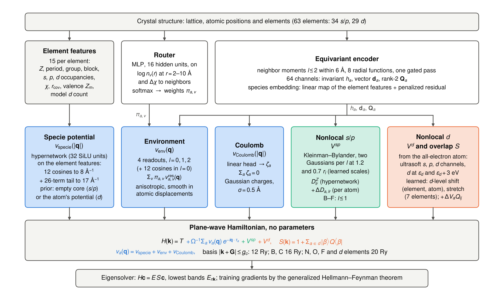

**Original caption:** **Fig. S1. The full network and the assembly of the Hamiltonian.** Gray: fixed inputs and operations; white: learned networks; blue, aqua and orange: the local potential and charges, the *s*/*p* projectors and the *d* channels, as in main-text Fig. 1. The encoder features h_a, **d**_a and Q_a feed the environment term, the charges and the per-atom corrections of both projector sets; the router weights π_a,ν mix the four environment readouts; a hypernetwork maps the element features to the specie potentials and to the specie projector strengths D^Z_lr.

**中文图注：****图 S1 · 完整网络与哈密顿量的组装。** 灰色为固定输入与固定操作；白色为学习到的网络；蓝、青、橙分别是局域势与电荷、s/p 投影子、d 通道，与正文图 1 一致。编码器特征 h_a、**d**_a、Q_a 供环境项、电荷以及两套投影子的逐原子修正使用；路由器权重 π_a,ν 混合四个环境读出；超网络把元素特征映射为种类势与种类投影子强度 D^Z_lr。

**Reading note:** 这张图是图 1 的"展开版"，值得对照看两件事：(1) 编码器只输出三类等变量（标量、矢量、秩 2 张量），这三类量同时驱动三个下游——环境势的四个多极读出、库仑电荷、以及 s/p 与 d 投影子的逐原子修正；也就是说**一次编码、多处复用**，这是参数量能压到 7.9 万的结构性原因。(2) 底部"Plane-wave Hamiltonian, no parameters"是全文的设计原则：从算符到 *H*(**k**) 的组装**不含任何可学习参数**，可学习的东西全部集中在"势"和"投影子强度"上。

**Source:** p.21 S102

**Original:** **Training loss.** The model is trained on the PBE band energies E^PBE_nk of each structure at the N_k points of its band path; E_nk are the predicted energies, n_v is the highest occupied band of the valence electron count and n_c = n_v + 1. For a gapped structure c the predicted bands are aligned at the valence-band maximum, Ẽ_nk = E_nk − E_VBM + E^PBE_VBM with E_VBM = max_k E_{n_v k}, and the loss is

$$L_c = \frac{\sum_{(n,\mathbf{k})\in W_c} w_n\left|\tilde{E}_{n\mathbf{k}} - E^{\mathrm{PBE}}_{n\mathbf{k}}\right|}{\sum_{(n,\mathbf{k})\in W_c} w_n} + \lambda_{\mathrm{gap}}\left|E_g - E^{\mathrm{PBE}}_g\right| + \frac{\lambda_{\mathrm{occ}}}{n_v N_k}\sum_{n\le n_v}\sum_{\mathbf{k}}\left|\tilde{E}_{n\mathbf{k}} - E^{\mathrm{PBE}}_{n\mathbf{k}}\right|. \tag{S1}$$

**中文：**式 (S1) 是有隙结构的损失：第一项是窗口 W_c 内能带误差的加权平均（带边两条能带权重 w_n = 5），第二项是带隙的绝对误差，第三项是全部占据带的弱正则项（λ_occ = 0.3）。

**Source:** p.21 S103

**Original:** The window W_c holds the states with |E^PBE_nk − E^PBE_mid| ≤ 2 eV, E^PBE_mid being the midgap, together with the two band-edge bands at every k, so that the edges are fitted whatever the gap; w_n = 5 for n = n_v, n_c and 1 otherwise. E_g = min_k E_{n_c k} − max_k E_{n_v k} is the signed predicted gap, negative when the bands overlap, so that a closed gap still has a gradient; λ_gap = 1 and λ_occ = 0.3. For gapped structures with open-shell *d* atoms, whose labels include the lowest 5N_d conduction bands, W_c is instead [E^PBE_VBM − h_c, E^PBE_CBM + h_c] with h_c = max(2 eV, E^PBE_top − E^PBE_CBM), E^PBE_top the top of the empty *d* manifold. For a metal the window M_c holds the states within 2 eV of the PBE Fermi level, the prediction is aligned by the rigid shift s_c = median_{(n,k)∈M_c}(E^PBE_nk − E_nk), which is not differentiated, and there is no gap term:

$$L_c = \frac{1}{|M_c|}\sum_{(n,\mathbf{k})\in M_c}\left|E_{n\mathbf{k}} + s_c - E^{\mathrm{PBE}}_{n\mathbf{k}}\right| + \frac{\lambda_{\mathrm{occ}}}{n_v N_k}\sum_{n\le n_v}\sum_{\mathbf{k}}\left|E_{n\mathbf{k}} + s_c - E^{\mathrm{PBE}}_{n\mathbf{k}}\right|. \tag{S2}$$

**中文：**式 (S2) 是金属的损失：先对窗口 M_c 内的预测取一个不参与求导的刚性平移 s_c（中位数），再计算平均绝对误差，且不含带隙项。

**Source:** p.22 S104

**Original:** Each step draws a batch 𝔅 of B = 16 training structures without replacement, with probability proportional to ω_c/√(N_sys(c)), where N_sys(c) is the number of training structures in the chemical system of c, so that large families do not dominate, and ω_c is the stage weight of Methods (4 for the new cells above 8 sites in the 24-site stage, 1.5 for the s/p cells in the final stage, 1 otherwise), and minimizes

$$L = \frac{1}{B}\sum_{c\in\mathfrak{B}} L_c + \lambda_{\mathrm{res}}\sum_{Z}\lVert r_Z\rVert^2 + \lambda_{\mathrm{emb}}\sum_{Z}\lVert e_Z\rVert^2, \tag{S3}$$

**中文：**每一步从训练结构中不放回地抽取一个大小为 B = 16 的批 𝔅，抽样概率正比于 ω_c/√(N_sys(c))，其中 N_sys(c) 是 c 所属化学体系中的训练结构数（以免大家庭主导），ω_c 是 Methods 中的阶段权重（24 位点阶段中 8 位点以上的新晶胞取 4；最后阶段 s/p 晶胞取 1.5；其余取 1），并最小化式 (S3)。

**Source:** p.22 S105

**Original:** where r_Z are the per-element residuals of the specie-potential coefficients (λ_res = 3×10⁻⁶) and e_Z the per-species residuals of the encoder's species embedding (λ_emb = 10⁻³). In the first stage, on the s/p compounds, a basis-consistency term (1/4n_v)Σ_{n≤n_v}Σ_{k∈K₄}|ΔE_nk − median ΔE|, with ΔE_nk = E_nk(20 Ry) − E_nk(g_c) at four k points K₄, was added with weight 1 for one structure per GPU and step. Gradients of L follow from the generalized Hellmann–Feynman theorem.

**中文：**其中 r_Z 是种类势系数的逐元素残差（λ_res = 3×10⁻⁶），e_Z 是编码器种类嵌入的逐种类残差（λ_emb = 10⁻³）。在第一阶段（s/p 化合物）中，另加入一个基组一致性项 (1/4n_v)Σ_{n≤n_v}Σ_{k∈K₄}|ΔE_nk − median ΔE|，其中 ΔE_nk = E_nk(20 Ry) − E_nk(g_c) 在四个 k 点 K₄ 上计算；每个 GPU、每个 step 抽取一个结构，权重为 1。L 的梯度由广义 Hellmann–Feynman 定理给出。

**Source:** p.22 S106

**Original:** **2. Accuracy and band structures of held-out structures.** Table S1 gives the accuracy of the final model in three major groups, including (i) held-out structure types, (ii) the sealed chemical systems and (iii) cells of 25–60 sites. By group the median gap error is 0.109 eV (*d*¹⁰), 0.131 eV (early *d*), 0.102 eV (4*d*/5*d*), 0.103 eV (open-shell 3*d*, 14 gapped structures) and 0.084 eV (*s*/*p*). Restricted to compounds within 0.1 eV/atom of the convex hull, the median gap errors are 0.105, 0.122 and 0.100 eV for the three larger groups. Structure types absent from training are harder (0.076 eV), and the difference is concentrated in one family. Held-out structure types containing 4*d*/5*d* elements are dominated by metastable mixed Mo/W chalcogenide stacks (141 of 314 structures, mostly 0.07–0.23 eV/atom above the hull), with a median band error of 0.22 eV; for the structures within 0.05 eV/atom of the hull the error is 0.067 eV. The sealed chemical systems, set aside before training and scored once with the final model, confirm these numbers: over 1,210 structures the median band error is 0.061 eV (74% within 0.1 eV), between 0.049 and 0.068 eV in every group, and the gap error 0.094 eV over 605 gapped structures.

**中文：****2. 留出结构的精度与能带结构。**表 S1 给出最终模型在三大组上的精度：（i）留出的结构类型；（ii）封存的化学体系；（iii）25–60 位点的晶胞。按分组，带隙误差中位数为：d¹⁰ 0.109 eV、早期 d 0.131 eV、4d/5d 0.102 eV、开壳层 3d 0.103 eV（14 个有隙结构）、s/p 0.084 eV。若只统计位于凸包以上 0.1 eV/atom 以内的化合物，后三组的带隙误差中位数为 0.105、0.122 与 0.100 eV。训练中不存在的结构类型更难（0.076 eV），且差异集中于**一个族**：含 4d/5d 元素的留出结构类型以亚稳的混合 Mo/W 硫族化物堆叠为主（314 个结构中的 141 个，大多位于凸包以上 0.07–0.23 eV/atom），其能带误差中位数为 0.22 eV；而对凸包以上 0.05 eV/atom 以内的结构，误差为 0.067 eV。封存的化学体系（训练前即封存、只用最终模型打分一次）印证了这些数字：在 1,210 个结构上能带误差中位数为 0.061 eV（74% 在 0.1 eV 内），各组均在 0.049–0.068 eV 之间；605 个有隙结构的带隙误差为 0.094 eV。

**Source:** p.22 S107

**Original:** Larger cells of 25–60 sites and up to about 25,000 plane waves, beyond the 24 sites and 8,700 plane waves of training, are somewhat harder. For these cases, the band and gap errors are 0.066 and 0.112 eV for 575 held-out *s*/*p* structures and 0.073 and 0.136 eV for 471 with *d* elements, the gap error rising most for 4*d*/5*d* compounds (0.161 eV). This suggests that the model may not have fully learned either the atomic environment or long-range interactions of the larger cells. To further boost the model's performance, one could consider including more large-cell structures in the training set or employing data augmentation techniques to better capture the physics of these systems.

**中文：**更大的晶胞（25–60 位点、最多约 25,000 个平面波，超出训练时的 24 位点与 8,700 个平面波）难度更高：在这些情形下，575 个留出 s/p 结构的能带与带隙误差为 0.066 与 0.112 eV，471 个含 d 元素的结构为 0.073 与 0.136 eV；带隙误差在 4d/5d 化合物上升幅最大（0.161 eV）。这提示模型可能没有完全学到较大晶胞的原子环境或长程相互作用。为进一步提升性能，可以考虑在训练集中加入更多大晶胞结构，或采用数据增强技术以更好地捕捉这类体系的物理。

**Source:** p.22 S108

**Original:** Fig. S2 shows band structures of held-out compounds, including the median and 90th-percentile *s*/*p* structures, the median structure of each *d* group, and the 75th- and 90th-percentile *d* structures.

**中文：**图 S2 给出留出化合物的能带结构，包括 s/p 结构的中位数与第 90 百分位样例、每个 d 组的中位数样例，以及 d 结构的第 75 与第 90 百分位样例。

### 图 S2 · 留出化合物的能带结构

**Placed near:** p.22 S108
**Source:** p.23 C007

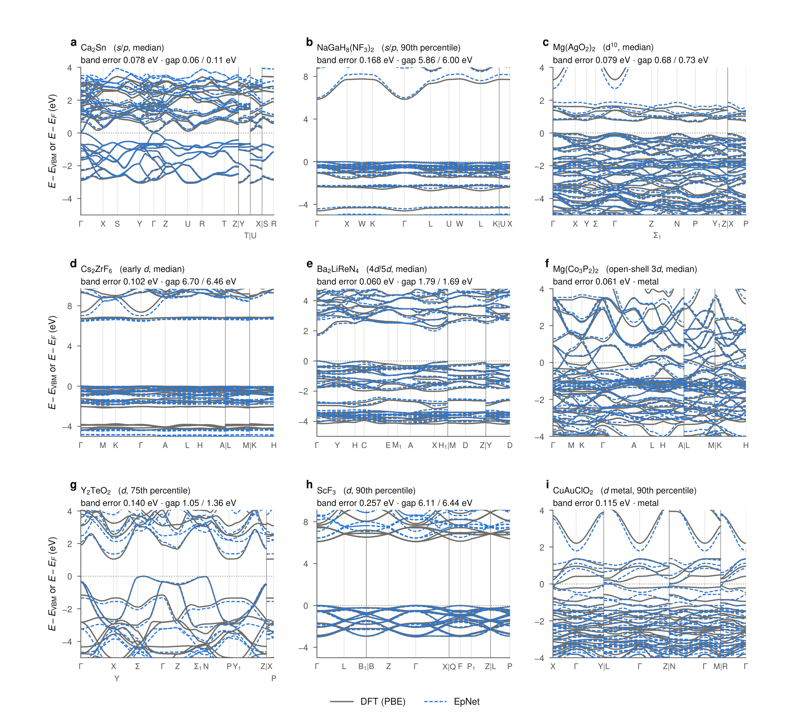

**Original caption:** **Fig. S2. Band structures of held-out compounds.** PBE (gray) and EpNet (blue, dashed) for structures whose chemical systems are absent from training, chosen by rank among the held-out structures of up to 3,000 plane waves: **a**,**b**, the median and 90th-percentile gapped *s*/*p* compounds; **c**,**d**, the median gapped *d*¹⁰ and early-*d* compounds; **e**,**f**, the median 4*d*/5*d* and open-shell 3*d* structures; **g**,**h**, the 75th- and 90th-percentile gapped structures with *d* elements; **i**, the 90th-percentile metal with *d* elements.

**中文图注：****图 S2 · 留出化合物的能带结构。** 化学体系不在训练集中的结构的 PBE（灰色）与 EpNet（蓝色虚线），按 3,000 平面波以内的留出结构排名选取：**a**、**b**，有隙 s/p 化合物的中位数与第 90 百分位；**c**、**d**，有隙 d¹⁰ 与早期 d 化合物的中位数；**e**、**f**，4d/5d 与开壳层 3d 结构的中位数；**g**、**h**，含 d 元素的有隙结构的第 75 与第 90 百分位；**i**，含 d 元素的金属的第 90 百分位。

**Reading note:** 建议重点看 g–i 三个面板——它们是"最难的一档"，能看出失效模式而不是成功案例：g（Y₂TeO₂，140 meV）主要是导带整体偏移；h（ScF₃，257 meV）是宽禁带氟化物，导带形状对得上但位置偏高；i（CuAuClO₂，金属，115 meV）显示费米能级附近的色散仍能跟上。这些偏差的方向与正文/SI 的局限分析一致（d⁰ 高配位氟化物导带偏高）。

### 表 S1 · 留出结构上的精度

**Placed near:** p.22 S106
**Source:** p.24 C008

**Original caption:** **Table S1. Accuracy on held-out structures.** Band error is the mean absolute error of the band energies within ±2 eV of midgap or the Fermi level, median over structures. Gap error is the median absolute error of the band gap over gapped structures. A structure counts in every group whose elements it contains: *d*¹⁰ (Cu, Ag, Au, Zn, Cd, Hg), early *d* (Sc, Y, Ti, Zr, Hf, V, Nb, Ta), 4*d*/5*d* (Mo, Tc, Ru, Rh, Pd, W, Re, Os, Ir, Pt), open-shell 3*d* (Cr, Mn, Fe, Co, Ni).

**中文图注：****表 S1 · 留出结构上的精度。** 能带误差是带隙中点或费米能级 ±2 eV 内能带能量的平均绝对误差（对结构取中位数）。带隙误差是有隙结构带隙绝对误差的中位数。一个结构只要含某组的元素，就同时计入该组：d¹⁰（Cu、Ag、Au、Zn、Cd、Hg）、早期 d（Sc、Y、Ti、Zr、Hf、V、Nb、Ta）、4d/5d（Mo、Tc、Ru、Rh、Pd、W、Re、Os、Ir、Pt）、开壳层 3d（Cr、Mn、Fe、Co、Ni）。

| 集合 | 结构数 | 能带误差 (eV) | ≤0.1 eV 占比 | 有隙结构数 | 带隙误差 (eV) |
|---|---|---|---|---|---|
| 留出化学体系（合计） | 2,050 | 0.061 | 74% | 964 | 0.102 |
| ├ 仅含 s/p 元素 | 639 | 0.065 | 71% | 466 | 0.084 |
| ├ 含 d¹⁰ 元素 | 555 | 0.057 | 76% | 226 | 0.109 |
| ├ 含早期 d 元素 | 589 | 0.058 | 76% | 196 | 0.131 |
| ├ 含 4d/5d 元素 | 423 | 0.050 | 81% | 82 | 0.102 |
| └ 含开壳层 3d 元素 | 177 | 0.056 | 82% | 14 | 0.103 |
| 留出的结构类型 | 953 | 0.076 | 62% | 377 | 0.110 |
| 封存的化学体系 | 1,210 | 0.061 | 74% | 605 | 0.094 |
| 留出，25–60 位点，仅 s/p | 575 | 0.066 | 69% | 541 | 0.112 |
| 留出，25–60 位点，含 d | 471 | 0.073 | 64% | 350 | 0.136 |

**Source:** p.24 S109

**Original:** **3. Atomic construction of *d* channels.** We first tested whether the operator used for the *s*/*p* elements, with its *l* = 2 Kleinman–Bylander projector placed at the *d*-orbital radius, can represent *d*-electron band structures at all. Fitted to each of 45 small crystals spanning the *d* block separately, it reached 0.1 eV on at most 12 of them. This motivated us to consider the atomic construction of *d* orbitals.

**中文：****3. d 通道的原子构造。**我们首先检验：用于 s/p 元素的那个算符——把 *l* = 2 的 Kleinman–Bylander 投影子放在 d 轨道半径处——究竟能否表示 d 电子能带结构。对跨越 d 区的 45 个小晶体逐一拟合，它最多只让其中 12 个达到 0.1 eV。这促使我们转向 d 轨道的**原子构造**。

**Source:** p.24 S110

**Original:** Fig. S3 shows the tests of that construction. For seven *d*¹⁰ compounds we placed the *d* element at its atomic construction, with no environment terms, next to anion potentials trained on *s*/*p* compounds only (Fig. S3d,e). A norm-conserving *d* orbital, renormalized inside the core radius, scales up the all-electron tail (2.9 times for Cu, see Fig. S3a), and the *d* bands come out 3.7–10.6 times too wide even after their center is placed correctly (Fig. S3e). Keeping the tail and restoring the norm with the overlap operator reduces the *d*–*d* overlap to its physical size. Two further ingredients are each needed: the atom's own local potential (Fig. S3b) and a second reference energy (Fig. S3c). With all three, the zero-shot *d*-band widths come within 1.13–1.26 times PBE for all seven compounds, with band errors of 0.05–0.35 eV before any training. For all 29 *d* elements the constructed pseudo-atom reproduces the all-electron *d* level within 0.04 eV, with a positive-definite overlap and no spurious bound states⁵⁷.

**中文：**图 S3 展示了这一构造的检验。对七个 d¹⁰ 化合物，我们把 d 元素放在其原子构造上、不加任何环境项，与仅在 s/p 化合物上训练的阴离子势并列（图 S3d,e）。一个在芯半径内重归一化的模守恒 d 轨道会把全电子尾部放大（Cu 为 2.9 倍，见图 S3a），即使把带中心放对，d 带也会宽出 3.7–10.6 倍（图 S3e）。保留尾部、用重叠算符恢复模，就把 d–d 重叠降到物理量级。此外还需两个成分：原子自身的局域势（图 S3b）与第二个参考能量（图 S3c）。三者齐备后，七个化合物的"零样本"d 带宽度都落在 PBE 的 1.13–1.26 倍以内，在任何训练之前的能带误差为 0.05–0.35 eV。对全部 29 种 d 元素，构造出的赝原子把全电子 d 能级重现到 0.04 eV 以内，重叠正定且无虚假束缚态⁵⁷。表 S2 列出每种元素通道的参数，式 (S4)–(S9) 说明它们如何进入。

### 图 S3 · 从原子构造 d 通道（完整构造检验）

**Placed near:** p.24 S110
**Source:** p.25 C009

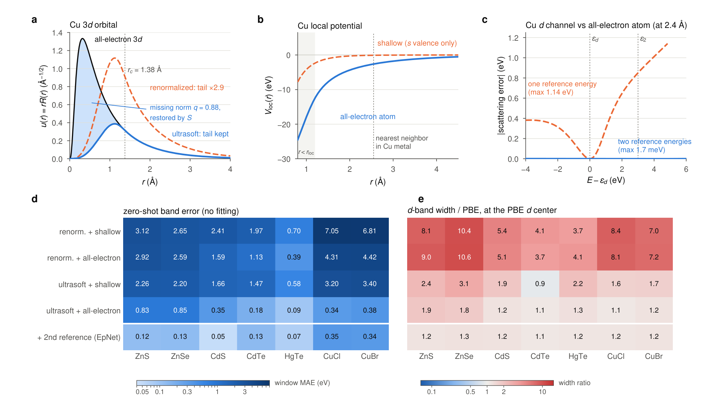

**Original caption:** **Fig. S3. Building the *d* channel from the atom (full construction tests).** **a**, Cu 3*d* orbital: all-electron (black), the ultrasoft pseudo-orbital that keeps the all-electron tail (blue) and a norm-conserving pseudo-orbital obtained by renormalizing it (orange). The shading is the norm restored by the overlap operator. **b**, Cu local potential: the neutral all-electron atom beyond r_loc (blue) and the shallow s-valence empty core (orange). **c**, Error of the Cu *d* channel in scattering energy against the all-electron atom, at 2.4 Å, for one and two reference energies. **d**,**e**, Zero-shot test of the *d* element at its atomic construction and anion potentials trained on *s*/*p* compounds only, for seven *d*¹⁰ compounds and five constructions. **d**, Band error in the ±2 eV window. **e**, Width of the *d* band relative to PBE after shifting the *d* level onto the PBE *d*-band center.

**中文图注：****图 S3 · 从原子构造 d 通道（完整构造检验）。** **a**，Cu 的 3d 轨道：全电子（黑）、保持全电子尾部的超软赝轨道（蓝）、重归一化得到的模守恒赝轨道（橙）；阴影为重叠算符恢复的模。**b**，Cu 的局域势：r_loc 之外的中性全电子原子势（蓝）与浅的 s 价空芯（橙）。**c**，在 2.4 Å 处，Cu 的 d 通道相对全电子原子的散射能量误差，比较一个与两个参考能量。**d**、**e**，把 d 元素放在其原子构造上、与仅在 s/p 化合物上训练的阴离子势组合的零样本测试，覆盖七个 d¹⁰ 化合物与五种构造。**d**，±2 eV 窗口内的能带误差。**e**，把 d 能级移到 PBE d 带中心之后，d 带宽度相对 PBE 的比值。

**Reading note:** 这张图是方法部分最有信息量的"阴性对照"实验。d 面板把五种构造放在一起比较：重归一化 + 浅 s 价空芯（灰色，最差，误差 3–10 eV）→ 重归一化 + 全电子势（橙色）→ 超软 + 浅空芯（红色）→ 超软 + 全电子势（蓝绿）→ 再加第二参考能量（绿色，最好）。它清楚显示**四个要素缺一不可**，尤其"保留全电子尾部"这一项对 d 带宽度是决定性的（e 面板的比值从 3–10 倍收敛到 1.1–1.3 倍）。

**Source:** p.24 S111

**Original:** **Construction of the atomic channels.** The parameters of Table S2 enter the channels as follows. The all-electron atom gives the valence levels ε_l (ε_s, ε_p and ε_d), which are the reference energies, and the radial orbitals u_l(r) = rR_l(r), normalized to one. Inside a core radius r^l_c each orbital is replaced by a smooth, nodeless polynomial,

$$\phi_l(r) = \begin{cases} r^{l+1}\left(a + br^2 + cr^4\right), & r < r^l_c,\\[2pt] u_l(r), & r \ge r^l_c,\end{cases} \tag{S4}$$

**中文：****原子通道的构造。**表 S2 的参数按如下方式进入各通道。全电子原子给出价能级 ε_l（ε_s、ε_p、ε_d），即参考能量，以及径向轨道 u_l(r) = rR_l(r)（归一化为 1）。在芯半径 r^l_c 以内，每个轨道被一个平滑、无节点的多项式取代，即式 (S4)。

**Source:** p.24–25 S112

**Original:** with a, b and c fixed by the value, slope and curvature of u_l at r^l_c; r^l_c is the smallest radius at which φ_l is nodeless and its plane-wave components above 20 Ry carry less than 0.05 eV of kinetic energy. The pseudo-orbital is not renormalized: beyond r^l_c it is the all-electron orbital, and inside it lacks the norm

$$q_l = \int_0^{r^l_c}\left(u_l^2 - \phi_l^2\right)dr, \tag{S5}$$

**中文：**其中 a、b、c 由 u_l 在 r^l_c 处的数值、斜率与曲率确定；r^l_c 是使 φ_l 无节点、且其 20 Ry 以上平面波分量所携带动能小于 0.05 eV 的最小半径。赝轨道**不重归一化**：在 r^l_c 之外它就是全电子轨道，在以内则缺失式 (S5) 所给出的模。

**Source:** p.25 S113

**Original:** which is q_d for the *d* channel (0.01–0.02 for s and p). The local potential is the atom's self-consistent potential V_AE(r) beyond r_loc and an even polynomial inside,

$$V_{\mathrm{loc}}(r) = \begin{cases} a' + b'r^2 + c'r^4, & r < r_{\mathrm{loc}},\\[2pt] V_{\mathrm{AE}}(r), & r \ge r_{\mathrm{loc}},\end{cases} \tag{S6}$$

**中文：**式 (S6) 定义 d 元素的局域势：r_loc 以内是偶多项式 a′ + b′r² + c′r⁴，以外是中性原子的全电子自洽势 V_AE(r)；两者在 r_loc 处的数值、斜率与曲率连续。

**Source:** p.25 S114

**Original:** matched in value, slope and curvature at r_loc; it is the fixed table *v*(**q**) in the *d* element's *v*_specie (Methods), to which the learned part is added. The *d* channel has a second reference: the all-electron solution regular at the origin at ε_d + Δε₂, pseudized by equation (S4) at the same r^d_c. With i, j = 1, 2 labeling the two references (φ₁ = φ_d, u₁ = u_d and ε₁ = ε_d; ε₂ = ε_d + Δε₂) and all integrals taken within r_cut = max(r^d_c, r_loc) + 0.3 Å,

$$\chi_i = (\varepsilon_i - T_2 - V_{\mathrm{loc}})\phi_i,\quad B_{ij} = \langle\phi_i|\chi_j\rangle,\quad \beta_i = \sum_j\left(B^{-1}\right)_{ji}\chi_j, \tag{S7}$$

$$Q_{ij} = \langle u_i|u_j\rangle - \langle\phi_i|\phi_j\rangle,\quad D_{ij} = B_{ij} + \varepsilon_j Q_{ij}, \tag{S8}$$

**中文：**式 (S7) 用 ε_i 与 V_loc 构造 χ_i，再由矩阵 B_ij 求双正交化的投影子 β_i；式 (S8) 给出模亏损 Q_ij 与投影子强度 D_ij = B_ij + ε_jQ_ij。所有积分都在 r_cut = max(r^d_c, r_loc) + 0.3 Å 以内。

**Source:** p.26 S115

**Original:** where T_l = −(ħ²/2m)[d²/dr² − l(l+1)/r²] and Q₁₁ = q_d (in the model Q is replaced by its positive-semidefinite part, a change below 0.003). The projectors are dual to the pseudo-orbitals, ⟨β_i|φ_j⟩ = δ_ij, so the channel and its overlap,

$$V_d = \sum_{ij}|\beta_i\rangle D_{ij}\langle\beta_j|,\qquad S = 1 + \sum_{ij}|\beta_i\rangle Q_{ij}\langle\beta_j|, \tag{S9}$$

**中文：**式 (S9) 是 d 通道的最终形式：*V*_d = Σ|β_i⟩D_ij⟨β_j|，*S* = 1 + Σ|β_i⟩Q_ij⟨β_j|。其中 T_l = −(ħ²/2m)[d²/dr² − *l*(*l*+1)/r²] 为径向动能算符，Q₁₁ = q_d（模型中 Q 用其半正定部分替代，变化小于 0.003）。

**Source:** p.26 S116

**Original:** give (T₂ + V_loc + V_d)φ_i = ε_iSφ_i and ⟨φ_i|S|φ_j⟩ = ⟨u_i|u_j⟩. At both reference energies, the pseudo-atom therefore has the all-electron level, the all-electron orbital beyond r^d_c and the all-electron norm. The s and p channels are the one-reference case, β_l = χ_l/a_l with a_l = ⟨φ_l|χ_l⟩, D_l = a_l + ε_lq_l and Q_l = q_l.

**中文：**由此 (T₂ + V_loc + V_d)φ_i = ε_iSφ_i 且 ⟨φ_i|S|φ_j⟩ = ⟨u_i|u_j⟩。因此在两个参考能量上，赝原子都拥有全电子能级、r^d_c 之外的全电子轨道，以及全电子的模。s 与 p 通道是单参考情形：β_l = χ_l/a_l，其中 a_l = ⟨φ_l|χ_l⟩，D_l = a_l + ε_lq_l，Q_l = q_l。

**Source:** p.26 S117

**Original:** In the crystal, β_i(r) with the spherical harmonics Y_2m is transformed to |**k** + **G**| and placed on every atom, and equations (S7)–(S9) are re-evaluated with the current V_loc at every training step, so that they hold throughout. Two corrections are learned on top of them: (i) a *d*-level shift δ per element and per atom, applied as D_ij → D_ij + δ⟨u_i|u_j⟩ so that it does not enter B; and (ii), for the seven elements with a value of e_max, a stretch of the orbitals, φ_i(r) → λ^{−1/2}φ_i(r/λ) with λ = exp[ln(1+e_max)tanh x] and x learned, so that (1+e_max)^{−1} ≤ λ ≤ 1+e_max. In addition, the augmentation term D_ij → D_ij + ΔV_aQ_ij is added; it has no parameters of its own. Δε₂ and e_max were set for conditioning before any training: Δε₂ is the offset among 3, 4, 5 and 6 eV that minimizes the largest eigenvalue of QG, with G_ij = ⟨β_i|β_j⟩, and e_max the largest stretch (in steps of 0.0125, up to 0.15) over which the largest eigenvalues of QG and |D|G stay within three times their atomic values; below 0.025 the stretch is fixed. The last two columns of Table S2 are checks, not inputs: the pseudo-atom built from equations (S4)–(S9) is solved in a 20 Ry plane-wave basis, δε_d is the error of its *d* level against the all-electron one, and S_min is the smallest eigenvalue of its overlap matrix, which must be positive for Hψ = ESψ to be well posed.

**中文：**在晶体中，带球谐 Y_2m 的 β_i(r) 被变换到 |**k** + **G**| 空间并放置在每个原子上；式 (S7)–(S9) 在每个训练 step 都用当前的 V_loc 重新求值，从而始终成立。在此之上还学习两项修正：（i）逐元素、逐原子的 d 能级平移 δ，以 D_ij → D_ij + δ⟨u_i|u_j⟩ 施加，因此不进入 B；（ii）对七个有 e_max 值的元素，轨道伸缩 φ_i(r) → λ^{−1/2}φ_i(r/λ)，其中 λ = exp[ln(1+e_max)tanh x]、x 可学习，满足 (1+e_max)^{−1} ≤ λ ≤ 1+e_max。此外还加入增广项 D_ij → D_ij + ΔV_aQ_ij，该项自身没有参数。Δε₂ 与 e_max 在任何训练之前就为数值条件设定：Δε₂ 在 3、4、5、6 eV 中选取使 QG 最大本征值最小的偏移（G_ij = ⟨β_i|β_j⟩）；e_max 是使 QG 与 |D|G 的最大本征值都保持在其原子值三倍以内的最大伸缩量（以 0.0125 为步长，上限 0.15）；小于 0.025 时伸缩固定。表 S2 的最后两列是**检验值而非输入**：由式 (S4)–(S9) 构造的赝原子在 20 Ry 平面波基下求解，δε_d 是其 d 能级相对全电子能级的误差，S_min 是其重叠矩阵的最小本征值——后者必须为正，Hψ = ESψ 才是良定的。

### 表 S2 · 29 种 d 元素的原子通道参数

**Placed near:** p.25 S112
**Source:** p.27 C010

**Original caption:** **Table S2. Atomic channels of the 29 *d* elements** (the tables the model uses; built from the neutral, scalar-relativistic all-electron atom in the local-density approximation, as in equations (S4)–(S9)). ε_s, ε_p, ε_d: reference energies of the s, p and d channels, the all-electron levels of the atom; r_c: pseudization radii; q_d: norm deficit of the *d* pseudo-orbital, restored by the overlap operator; r_loc: radius beyond which the local potential is the atom's own; Δε₂: second *d* reference energy above ε_d; e_max: bound of the learned orbital stretch λ, (1+e_max)^{−1} ≤ λ ≤ 1+e_max; –: not learned (λ = 1); δε_d: error of the pseudo-atom's *d* level at 20 Ry against the all-electron one; S_min: smallest eigenvalue of the pseudo-atom's overlap.

**中文图注：****表 S2 · 29 种 d 元素的原子通道参数**（模型实际使用的表；按式 (S4)–(S9) 从局域密度近似下的中性、标量相对论全电子原子构造）。ε_s、ε_p、ε_d：s、p、d 通道的参考能量（即原子的全电子能级）；r_c：伪化半径；q_d：d 赝轨道的模亏损，由重叠算符恢复；r_loc：超过该半径后局域势即原子自身势；Δε₂：位于 ε_d 之上的第二 d 参考能量；e_max：学习到的轨道伸缩 λ 的界，(1+e_max)^{−1} ≤ λ ≤ 1+e_max；–：不学习（λ = 1）；δε_d：赝原子 d 能级在 20 Ry 下相对全电子能级的误差；S_min：赝原子重叠矩阵的最小本征值。

| 元素 | ε_s (eV) | ε_p (eV) | ε_d (eV) | r_c^s (Å) | r_c^p (Å) | r_c^d (Å) | q_d | r_loc (Å) | Δε₂ (eV) | e_max | δε_d (meV) | S_min |
|---|---|---|---|---|---|---|---|---|---|---|---|---|
| Sc | −4.30 | −1.52 | −3.43 | 1.19 | 1.23 | 1.22 | 0.48 | 1.4 | 6 | 0.088 | 28 | 0.97 |
| Ti | −4.60 | −1.54 | −4.46 | 1.11 | 1.14 | 1.24 | 0.59 | 1.2 | 3 | – | 18 | 0.95 |
| V | −4.85 | −1.53 | −5.38 | 1.06 | 1.07 | 1.27 | 0.68 | 1.2 | 3 | – | 15 | 0.96 |
| Cr | −4.20 | −1.08 | −3.13 | 1.01 | 1.03 | 1.24 | 0.65 | 1.2 | 3 | – | 16 | 0.96 |
| Mn | −5.29 | −1.47 | −7.01 | 0.95 | 0.95 | 1.38 | 0.82 | 1.2 | 3 | – | 9 | 0.98 |
| Fe | −5.49 | −1.44 | −7.75 | 0.90 | 0.90 | 1.38 | 0.86 | 1.2 | 3 | – | 8 | 0.98 |
| Co | −5.68 | −1.39 | −8.46 | 0.87 | 0.87 | 1.38 | 0.88 | 1.2 | 3 | – | 7 | 0.99 |
| Ni | −5.86 | −1.34 | −9.14 | 0.82 | 0.82 | 1.38 | 0.90 | 1.2 | 3 | – | 6 | 0.99 |
| Cu | −4.86 | −0.79 | −5.33 | 0.79 | 0.82 | 1.38 | 0.88 | 1.2 | 3 | – | 6 | 0.99 |
| Zn | −6.22 | −1.23 | −10.43 | 0.77 | 0.77 | 1.38 | 0.93 | 1.2 | 3 | – | 5 | 1.00 |
| Y | −4.23 | −1.50 | −2.65 | 1.36 | 1.49 | 0.77 | 0.02 | 1.8 | 3 | 0.025 | 39 | 1.00 |
| Zr | −4.59 | −1.55 | −3.74 | 1.30 | 1.39 | 1.16 | 0.21 | 1.8 | 3 | – | 33 | 0.99 |
| Nb | −4.20 | −1.22 | −3.21 | 1.23 | 1.33 | 1.19 | 0.27 | 1.4 | 3 | 0.15 | 30 | 0.92 |
| Mo | −4.33 | −1.16 | −3.94 | 1.17 | 1.26 | 1.22 | 0.37 | 1.4 | 3 | 0.15 | 28 | 0.92 |
| Tc | −5.26 | −1.52 | −6.81 | 1.11 | 1.18 | 1.27 | 0.52 | 1.2 | 3 | – | 22 | 0.93 |
| Ru | −4.52 | −1.04 | −5.40 | 1.08 | 1.15 | 1.27 | 0.55 | 1.2 | 3 | – | 21 | 0.93 |
| Rh | −4.59 | −0.97 | −6.15 | 1.06 | 1.10 | 1.32 | 0.64 | 1.2 | 3 | – | 16 | 0.94 |
| Pd | −3.62 | −0.36 | −4.31 | 1.03 | 1.08 | 1.30 | 0.64 | 1.2 | 3 | – | 17 | 0.94 |
| Ag | −4.72 | −0.85 | −7.66 | 0.98 | 1.03 | 1.38 | 0.76 | 1.2 | 3 | – | 13 | 0.95 |
| Cd | −5.96 | −1.33 | −11.90 | 0.93 | 0.98 | 1.38 | 0.83 | 1.2 | 3 | – | 12 | 0.95 |
| Hf | −5.26 | −1.47 | −2.88 | 1.18 | 1.35 | 1.14 | 0.15 | 1.6 | 3 | 0.15 | 36 | 0.98 |
| Ta | −5.62 | −1.48 | −3.79 | 1.16 | 1.29 | 1.19 | 0.23 | 1.4 | 3 | 0.15 | 30 | 0.92 |
| W | −5.91 | −1.47 | −4.69 | 1.11 | 1.26 | 1.22 | 0.31 | 1.2 | 3 | 0.15 | 28 | 0.93 |
| Re | −6.16 | −1.44 | −5.58 | 1.08 | 1.20 | 1.24 | 0.39 | 1.2 | 3 | – | 26 | 0.92 |
| Os | −6.38 | −1.40 | −6.47 | 1.06 | 1.17 | 1.27 | 0.47 | 1.2 | 3 | – | 23 | 0.92 |
| Ir | −6.59 | −1.35 | −7.36 | 1.01 | 1.12 | 1.30 | 0.54 | 1.2 | 3 | – | 21 | 0.92 |
| Pt | −5.96 | −0.96 | −6.38 | 1.01 | 1.10 | 1.30 | 0.56 | 1.2 | 3 | – | 20 | 0.93 |
| Au | −6.08 | −0.89 | −7.12 | 0.98 | 1.08 | 1.38 | 0.67 | 1.2 | 3 | – | 16 | 0.93 |
| Hg | −7.13 | −1.19 | −10.08 | 0.93 | 1.03 | 1.38 | 0.73 | 1.2 | 3 | – | 16 | 0.94 |

**Source:** p.28 S118

**Original:** **4. Cost against cell size.** We selected 24 held-out structures, 4 per size range (1–2, 3–4, 5–8, 9–12, 13–16 and 17–24 sites), half of them with only *s*/*p* elements. They were computed with QE 7.3 on their standardized primitive cells, using PBE, SSSP 1.3 efficiency pseudopotentials with their recommended cutoffs and Marzari–Vanderbilt smearing of 0.01 Ry. Each calculation is a self-consistent run on a Γ-centered grid with 0.25 Å⁻¹ spacing followed by a bands run on EpNet's path k points, with 16 MPI processes in 4 pools on one Intel Xeon Gold 6248R node. The resulting gaps agree with the Materials Project's to a median of 0.018 eV. EpNet solves the same cells and k points, on one NVIDIA H100 and on 16 cores of the same node type. On the CPU, the path is split into four contiguous parts run by 4 processes of 4 threads, as QE's pools split the k points; this is a median 1.5 times faster than one process of 16 threads. EpNet times include setup and are taken after a first warm-up evaluation. Fig. S4 compares the wall time of a band structure in QE and EpNet for 24 held-out structures of 2–24 atoms with the same cells and k points. Overall, EpNet on one GPU is 1–2 orders of magnitude faster than QE, and the speedup grows with cell size up to 24 atoms; for the 16–24-atom cells EpNet takes 4–7 s per band structure and QE 345–984 s.

**中文：****4. 计算代价随晶胞尺寸的变化。**我们选取 24 个留出结构，每个尺寸区间（1–2、3–4、5–8、9–12、13–16、17–24 位点）各 4 个，一半只含 s/p 元素。它们在标准化后的原胞上用 QE 7.3 计算，采用 PBE、SSSP 1.3 效率型赝势及其推荐截断，以及 Marzari–Vanderbilt 展宽 0.01 Ry。每次计算都是先在以 Γ 为中心、间距 0.25 Å⁻¹ 的网格上做自洽计算，再在 EpNet 的路径 k 点上做能带计算；在一台 Intel Xeon Gold 6248R 节点上以 4 个 pool、16 个 MPI 进程运行。所得带隙与 Materials Project 的中位差为 0.018 eV。EpNet 在同一批晶胞与 k 点上求解，分别用一块 NVIDIA H100 和同类型节点的 16 个核心。在 CPU 上，路径被切成四段连续部分、由 4 个 4 线程的进程运行（正如 QE 用 pool 切分 k 点）；这比单个 16 线程进程的中位速度快 1.5 倍。EpNet 的计时含初始化，且在第一次热身求值之后才取。图 S4 比较了 24 个 2–24 原子留出结构在相同晶胞与 k 点下 QE 与 EpNet 计算一条能带结构的墙钟时间。总体而言，单块 GPU 上的 EpNet 比 QE 快 1–2 个数量级，且加速比随晶胞增大到 24 原子而增长；对 16–24 原子的晶胞，EpNet 每条能带结构需 4–7 s，QE 需 345–984 s。

### 图 S4 · 能带结构代价对晶胞尺寸（QE vs. EpNet）

**Placed near:** p.28 S118
**Source:** p.28 C011

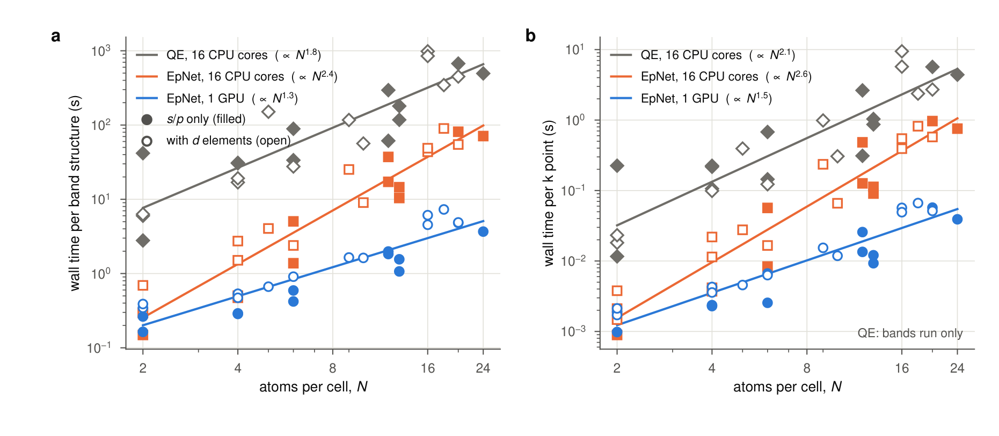

**Original caption:** **Fig. S4. Band-structure cost against cell size, Quantum ESPRESSO and EpNet.** 24 held-out structures of 2–24 atoms (filled, only *s*/*p* elements; open, with *d* elements), with the same cells and k points: QE 7.3 and EpNet on one NVIDIA H100 and on the same 16 cores. **a**, Wall time per band structure. **b**, Wall time per k point. Lines, power-law fits t ∝ N^p, exponents in the legend.

**中文图注：****图 S4 · 能带结构代价随晶胞尺寸的变化，Quantum ESPRESSO 与 EpNet。** 24 个 2–24 原子的留出结构（实心：仅 s/p 元素；空心：含 d 元素），相同晶胞与 k 点：QE 7.3 与 EpNet（一块 NVIDIA H100 及同样的 16 核心）。**a**，每条能带结构的墙钟时间。**b**，每个 k 点的墙钟时间。直线为幂律拟合 t ∝ N^p，指数见标注。

**Source:** p.28 S119

**Original:** Fig. S5 isolates the dependence on cell size with FCC supercells of Al and Cu of 1–512 atoms that share the same eight k points. For the scaling test (Fig. S5), we built n×n×n supercells (n = 1–8) of the Materials Project primitive cells of Al and Cu (mp-134, mp-30). Every supercell was given the same eight Cartesian k points, Γ and seven steps of 0.05 Å⁻¹ along a reciprocal-lattice vector of the primitive cell, and was computed with the same settings. QE runs of Al with 512 atoms and of Cu with 216 or more atoms are omitted due to high costs. Time per k point is the bands-run time (QE) or the total time (EpNet) divided by eight. Above 64 atoms, the time per k point of both codes grows as N^2.2–N^2.6, so EpNet's advantage is a constant factor rather than a lower exponent. Overall, EpNet on the H100 is 2–3 orders of magnitude faster than QE on 16 cores for large cells.

**中文：**图 S5 用 Al 与 Cu 的 1–512 原子面心立方超胞（共享同样八个 k 点）来单独考察对晶胞尺寸的依赖。为做标度测试（图 S5），我们用 Materials Project 中 Al 与 Cu 的原胞（mp-134、mp-30）构造 n×n×n 超胞（n = 1–8）。每个超胞都给同样的八个笛卡尔 k 点：Γ 加上沿原胞某一倒格矢方向、间隔 0.05 Å⁻¹ 的七个点，并用相同设置计算。由于代价过高，512 原子的 Al 与 216 原子以上的 Cu 的 QE 计算被省略。每 k 点时间是能带计算时间（QE）或总时间（EpNet）除以八。在 64 原子以上，两种代码的每 k 点时间都按 N^2.2–N^2.6 增长，因此 EpNet 的优势体现为一个常数因子，而不是更低的指数。总体上，对大晶胞，H100 上的 EpNet 比 16 核 QE 快 2–3 个数量级。

### 图 S5 · 每 k 点代价对晶胞尺寸（FCC 超胞）

**Placed near:** p.28 S119
**Source:** p.29 C012

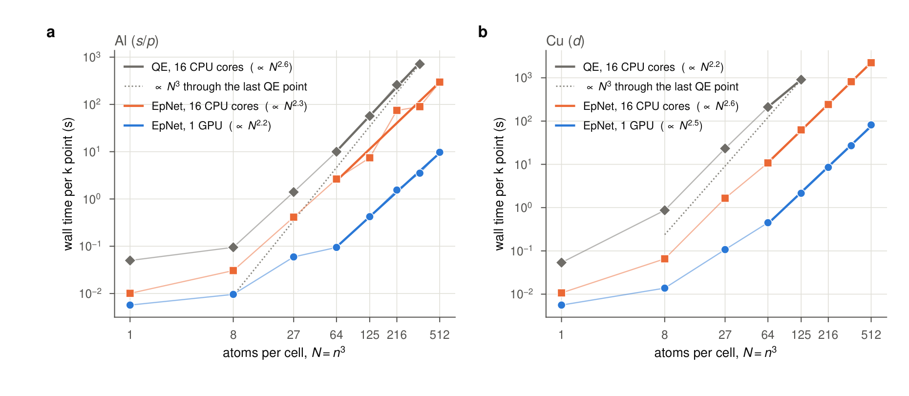

**Original caption:** **Fig. S5. Cost per k point against cell size on FCC supercells.** n×n×n supercells (n³ = 1–512 atoms) of the primitive cells of **a**, Al and **b**, Cu, each with the same eight k points, so that only the cell size changes: QE (bands run after its self-consistent field) on 16 Intel Xeon Gold 6248R cores and EpNet on the same 16 cores and on one NVIDIA H100. QE runs of Al with 512 atoms and of Cu with 216 or more atoms are omitted, so the QE fit for Cu uses two cells (64 and 125 atoms). Lines, power-law fits over N ≥ 64; dotted, N³ through the largest QE cell.

**中文图注：****图 S5 · 每 k 点代价随晶胞尺寸的变化（FCC 超胞）。** 原胞的 n×n×n 超胞（n³ = 1–512 原子）：**a** 为 Al，**b** 为 Cu；每个超胞都用同样八个 k 点，因此只有晶胞尺寸在变。对比 16 个 Intel Xeon Gold 6248R 核心上的 QE（自洽场之后的能带计算）与同样 16 核心及一块 NVIDIA H100 上的 EpNet。512 原子的 Al 与 216 原子以上的 Cu 的 QE 计算被省略，故 Cu 的 QE 拟合只用了两个晶胞（64 与 125 原子）。直线为 N ≥ 64 的幂律拟合；点线为穿过最大 QE 晶胞的 N³。

**Source:** p.29 S120

**Original:** **5. Comparison with alternative models.** Table S3. Comparison of selected existing machine learning models for electronic structure calculations.

**中文：****5. 与替代模型的比较。**表 S3：若干现有电子结构机器学习模型的对比。

### 表 S3 · 与现有电子结构机器学习模型的对比

**Placed near:** p.29 S120
**Source:** p.29 C013

**中文表题：****表 S3 · 若干现有电子结构机器学习模型的对比。**（原文仅有表题，无表注。）

| 方法与模型 | 输入 | 输出 | 训练标签 | 已报告精度 |
|---|---|---|---|---|
| **性质模型：** ALIGNN¹⁴、MEGNet¹²˒¹³、coGN¹⁵ | 结构 | 带隙或态密度 | 带隙或态密度 | 带隙平均误差 0.16 eV（coGN 在 Matbench¹⁶ 上，PBE） |
| **通用学习型 DFT 哈密顿量：** DeepH-UMM²³、UniHamGNN²⁴、NextHAM²⁵ | 结构，加上 DFT 代码的基组与重叠矩阵，或一个初始哈密顿量 | 原子轨道基下的哈密顿量 | 自洽哈密顿量矩阵 | 矩阵元误差 1.3–2.2 meV |
| **紧束缚：** DFTB⁺⁵⁸ 配 PTBP²⁹、ThreeBodyTB³⁰、g-xTB³¹ | 结构 | 最小基下的哈密顿量 | DFT 能量与能带结构 | 带隙相对 DFT 平均误差 0.67–0.82 eV³² |
| **可学习 EPM：** Kim & Son³⁶、Kang 等³⁷、Lin 等³⁸ | 结构 | 平面波哈密顿量 | DFT 势，或能带能量（DFT 或 GW） | 仅限单一元素或材料家族 |
| **EpNet（本工作）** | 结构 | 平面波哈密顿量 | 能带能量 | 留出化学体系：能带误差 0.061 eV，带隙 0.102 eV |

**Reading note:** 这张表把"竞争格局"交代得很清楚，也是理解论文定位的关键。四类方法的取舍是：性质模型**快但只给标量**（0.1 s 级、误差 0.28–0.56 eV，且金属/绝缘体判对率只有 88–89%）；学习型 DFT 哈密顿量**精度极高（meV 级矩阵元）但绑死基组与代码**，且真实能带误差比矩阵元误差大 10–50 倍；紧束缚**能出完整能带但基组太小**（0.67–0.82 eV）；可学习 EPM **物理形式对，但此前只能覆盖单一元素/窄家族**。EpNet 的位置是"EPM 的物理形式 + 跨 63 元素的覆盖 + 平面波基 + 只吃能带能量"，代价是要自己实现一条可微的本征值求解路径。

**Source:** p.29–30 S121

**Original:** **6. Limitations of the current EpNet model.** Among the *s*/*p* elements the first-row elements H, F, N, O and C have the largest held-out errors (main-text Fig. 2a), and on Alexandria the gaps of structures with hydrogen are the least accurate (0.19 eV), the worst being complex hydrides of *d* metals. Among the *d* elements, the largest gap errors are from *d*⁰ oxides and fluorides of high coordination, such as TiO₂ (Fig. S6a,b). In these structures, the *d* level does not drop as far as in PBE, and the gap is too large: in fluorite TiO₂ (0.31 eV/atom above the hull) the O 2p valence bands are reproduced to 0.03 eV, but the empty Ti 3d bands lie 0.76 eV too high, and the gap is 1.78 eV against 1.06 eV. These polymorphs lie 0.3–0.9 eV/atom above the hull and have no counterpart in the training data.

**中文：****6. 当前 EpNet 模型的局限。**在 s/p 元素中，第一行元素 H、F、N、O、C 的留出误差最大（正文图 2a）；在 Alexandria 上，含氢结构的带隙最不准确（0.19 eV），最差的是 d 金属的复杂氢化物。在 d 元素中，带隙误差最大的是**高配位的 d⁰ 氧化物与氟化物**，如 TiO₂（图 S6a,b）。在这类结构中，d 能级没有像 PBE 那样降得那么低，带隙偏大：在萤石型 TiO₂（凸包以上 0.31 eV/atom）中，O 2p 价带被重现到 0.03 eV，但空的 Ti 3d 带偏高 0.76 eV，带隙为 1.78 eV 而 PBE 为 1.06 eV。这些多形体位于凸包以上 0.3–0.9 eV/atom，训练数据中没有对应物。

**Source:** p.30 S122

**Original:** Another limit is the layered Mo/W chalcogenide stacks. Almost all of these cells (663 of the 668 Mo/W chalcogenides of space group P3̄m1) are bilayer or trilayer slabs, separated from their periodic images by about 13 Å of vacuum. In the held-out bilayer MoWSe₄ of Fig. S6c,d, the direct gap at Γ is 0.64 eV too small, because the lowest conduction band there is 0.61 eV too low, while the direct gap at K is 0.15 eV too small and the fundamental gap is 1.05 eV against 1.28 eV.

**中文：**另一个局限是层状 Mo/W 硫族化物堆叠。这类晶胞几乎全部（空间群 P3̄m1 的 668 个 Mo/W 硫族化物中的 663 个）是双层或三层薄片，与周期性镜像之间隔着约 13 Å 的真空。在图 S6c,d 的留出双层 MoWSe₄ 中，Γ 点的直接带隙偏小 0.64 eV，因为该处最低导带偏低 0.61 eV；K 点的直接带隙偏小 0.15 eV；基本带隙为 1.05 eV 而 PBE 为 1.28 eV。

**Source:** p.30 S123

**Original:** The first two groups' errors are likely to be fixable by including representative structures in the training set, while the last group may require a separate treatment of van der Waals interactions for the slabs. Finally, the charges of the *d* atoms are effective parameters rather than physical charges (main text, Fig. 4d). If the charges need to be physical for further applications (e.g., the electron density extraction from learned Hamiltonian), the models need to be retrained.

**中文：**前两组的误差很可能通过在训练集中加入代表性结构即可修正，而最后一组可能需要对薄片单独处理范德华相互作用。最后，d 原子的电荷是**有效参数而非物理电荷**（正文图 4d）。如果后续应用需要物理电荷（例如从学到的哈密顿量中提取电子密度），模型需要重新训练。

### 图 S6 · 模型的两个局限（留出化学体系）

**Placed near:** p.29 S121
**Source:** p.30 C014

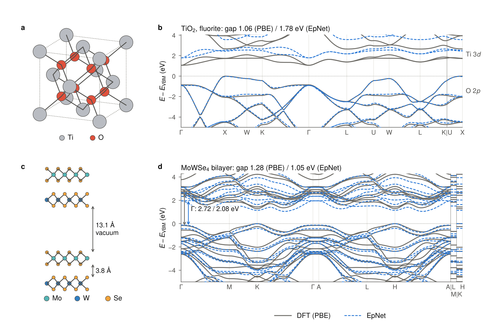

**Original caption:** **Fig. S6. Two limits of the model, on held-out chemical systems.** **a**, TiO₂ in the fluorite structure (mp-1008677, Fm3̄m, Ti eightfold), conventional cell. **b**, Its band structure, EpNet (blue, dashed) against PBE (gray), aligned at the valence-band maximum. **c**, MoWSe₄ (mp-1023928), a MoSe₂/WSe₂ bilayer, viewed edge-on to the layers over two cells along the layer normal, with the vacuum between periodic images and the van der Waals gap marked. **d**, Its band structure, as in **b**; arrows, the direct gap at Γ.

**中文图注：****图 S6 · 模型的两个局限（留出化学体系）。** **a**，萤石结构中的 TiO₂（mp-1008677，Fm3̄m，Ti 为八配位），常规晶胞。**b**，其能带结构：EpNet（蓝色虚线）对 PBE（灰色），在价带顶对齐。**c**，MoWSe₄（mp-1023928），即 MoSe₂/WSe₂ 双层，沿层法线方向跨两个晶胞侧视，标出周期性镜像之间的真空与范德华间隙。**d**，其能带结构，同 **b**；箭头为 Γ 点的直接带隙。

**Reading note:** 这两个案例正好对应两类"训练数据里没有的物理"。(1) 萤石 TiO₂ 是 d⁰ 高配位氧化物：Ti 的 3d 空带位置由晶体场与 O 2p 的 p–d 杂化共同决定，而训练集中这类"高对称、高配位、d⁰"的样本稀少，模型把空 d 带放高了 0.76 eV。(2) 双层 MoWSe₄ 的关键是层间范德华间隙——局域势的 6 Å 截断与平面波基都无法显式描述 vdW，所以 Γ 点导带偏低。作者的处理方式很克制：指出这两类可以靠"加数据"或"单独处理 vdW"解决，并把 d 原子电荷的非物理性一并列为需要重训的前提。

---

## 7 术语对照表

| 英文 | 中文 | 说明（本文语境） |
|---|---|---|
| empirical pseudopotential method (EPM) | 经验赝势方法 | 用少数拟合参数构造平面波哈密顿量，绕开自洽迭代的经典路线 |
| plane-wave Hamiltonian | 平面波哈密顿量 | 基组为 \|**k**+**G**⟩，矩阵元由原子形状因子组装（式 1） |
| local potential | 局域势 | 只依赖 **q** 模长的对角项；本文拆成种类势 + 环境势 + 库仑势（式 2） |
| specie potential | 种类势／元素势 | 每个元素一个、各向同性的基础势，由超网络从元素特征生成 |
| environment potential | 环境势 | 描述配位与成键的各向异性修正，含至 *l* = 2 的多极读出 |
| nonlocal projector | 非局域投影子 | 依赖角动量的算符；s/p 用高斯 KB 型，d 用全电子原子构造的超软型 |
| Kleinman–Bylander (KB) | Kleinman–Bylander 形式 | 把非局域赝势写成投影子 separable 形式的标准做法 |
| ultrasoft pseudopotential | 超软赝势 | 允许赝轨道在芯内少占模、由重叠算符补回；本文 d 通道采用 |
| norm-conserving | 模守恒 | 赝轨道在芯内保持与全电子轨道相同的模；本文证明对 d 带宽度不利 |
| norm deficit (q_d) | 模亏损 | 芯内缺失的模，由重叠算符 *S* 恢复 |
| overlap operator / matrix *S* | 重叠算符／重叠矩阵 | 超软情形下广义本征值问题 *H***c** = *E*·*S***c** 的 *S* |
| augmentation term | 增广项 | ΔV_aQ_ij，使 d 能级跟随晶体局域静电势 |
| equivariant neural network | 等变神经网络 | 输出随旋转/平移协变的标量、矢量、秩 2 张量特征 |
| hypernetwork | 超网络 | 从元素特征生成种类势系数与种类投影子强度的 MLP |
| router | 路由器 | 逐原子 softmax 权重，混合四个环境势读出 |
| readout | 读出（头） | 把编码器特征映射为形状因子/电荷的线性或小型网络层 |
| gated pass | 门控传递 | 编码器中用模长门控的消息传递 |
| Chebyshev-filtered subspace iteration | 切比雪夫滤波子空间迭代 | 大规模稀疏本征求解，用上一步本征矢作初值 |
| Hellmann–Feynman theorem (generalized) | （广义）Hellmann–Feynman 定理 | 给出能带对本征值问题参数的解析导数（式 6） |
| non-self-consistent | 非自洽 | EpNet 不做 SCF 循环，一次对角化即出能带 |
| convex hull | 凸包 | 热力学稳定性参照；本文筛选 0.1 eV/atom 以内的结构 |
| chemical system | 化学体系 | 共享同一组元素的所有结构；本文按此划分训练/测试，防同族泄漏 |
| structure type / prototype | 结构类型／原型 | 晶体结构原型的分类标签，也用于留出划分 |
| sealed chemical systems | 封存化学体系 | 训练前封存、只用最终模型打分一次的体系（单次盲测） |
| held-out / unseen | 留出／未见过 | 完全不在训练集中的化学体系或结构类型 |
| screening mode | 筛选模式 | 只取带隙、路径抽稀、容差 5 meV 的快速推理模式 |
| band error (window MAE) | 能带误差（窗口平均绝对误差） | 带隙中点或费米能级 ±2 eV 内的 MAE |
| gap error | 带隙误差 | 预测带隙与 PBE 带隙之差 |
| metal/insulator classification | 金属/绝缘体分类 | 筛选中重要的二分类指标，本文 98.9% |
| PBE | Perdew–Burke–Ernzerhof 泛函 | 训练标签所用的 GGA 泛函 |
| scalar-relativistic (ZORA) | 标量相对论（零阶正则近似） | d 原子求解所用的相对论近似层级 |
| SSSP | 标准固体赝势库 | QE 对比计算所用的赝势集合 |
| d¹⁰ / early d / 4d-5d / open-shell 3d | d¹⁰／早期 d／4d-5d／开壳层 3d | 论文划分的四个 d 区子类 |

---

## 8 关键公式速查

| 编号 | 公式 | 含义 |
|---|---|---|
| (1) | *H*_GG′(**k**) = (ħ²/2m)\|**k**+**G**\|²δ_GG′ + Ω⁻¹Σ_a v_a(Δ**G**)e^{−iΔ**G**·τ_a} + *V*^nl_GG′(**k**) | 平面波哈密顿量：动能 + 局域形状因子 + 非局域项 |
| (2) | v_a = v_specie + v_env + v_Coulomb；v_env = Σ_ν π_a,ν v^res_a,ν；v_Coulomb = −4πe²ζ_a/\|**q**\|²·e^{−σ²\|**q**\|²/2} | 局域势的三分解；库仑项是高斯电荷的屏蔽势 |
| (3) | D_ij = ⟨φ_i\|ε_j − *T* − *V*_loc\|φ_j⟩ + ε_jQ_ij；Q_ij = ⟨u_i\|u_j⟩ − ⟨φ_i\|φ_j⟩ | 超软 d 通道的投影子强度与模亏损（双参考能量） |
| (4) | v_specie(q) = Σ_{n=0}^{11}c^Z_nφ_n(q;8) + Σ_{n=0}^{25}t^Z_nφ_n(q;17)；φ_n = ½(1+cos πx)cos nπx | 种类势的余弦基展开：主项到 8 Å⁻¹，高 q 尾部到 17 Å⁻¹ |
| (5) | *V*^sp_GG′ = Σ_{a∈sp}Σ_{l≤l_max}Σ_{r=1,2}(D^Z_lr + ΔD_a,lr)Σ_m β^lm_ar(**p**)β^lm*_ar(**p**′) | s/p 的 KB 型非局域项：两个高斯半径 × 每个角动量 |
| (6) | ∂E_nk/∂θ = **c**†_nk(∂*H*/∂θ − E_nk∂*S*/∂θ)**c**_nk | 广义 Hellmann–Feynman：穿过本征值求解器的解析梯度 |
| (S1) | L_c = Σ_W w_n\|Ẽ−E^PBE\|/Σ_W w_n + λ_gap\|E_g−E^PBE_g\| + λ_occ/(n_vN_k)Σ\|Ẽ−E^PBE\| | 有隙结构损失：窗口 MAE + 带隙项 + 占据带弱正则 |
| (S2) | L_c = \|M_c\|⁻¹Σ_M\|E+s_c−E^PBE\| + λ_occ… | 金属损失：刚性平移后再比，无带隙项 |
| (S3) | L = B⁻¹Σ_c L_c + λ_resΣ_Z‖r_Z‖² + λ_embΣ_Z‖e_Z‖² | 批损失 + 两类残差正则 |
| (S4) | φ_l(r) = r^{l+1}(a+br²+cr⁴) (r<r^l_c)；否则 u_l(r) | 芯内平滑、无节点的赝轨道 |
| (S5) | q_l = ∫₀^{r^l_c}(u_l²−φ_l²)dr | 模亏损的定义 |
| (S6) | V_loc(r) = a′+b′r²+c′r⁴ (r<r_loc)；否则 V_AE(r) | 局域势：芯内多项式、芯外全电子自洽势 |
| (S7)–(S9) | χ_i=(ε_i−T₂−V_loc)φ_i；B_ij=⟨φ_i\|χ_j⟩；β_i=Σ_j(B⁻¹)_jiχ_j；Q_ij=⟨u_i\|u_j⟩−⟨φ_i\|φ_j⟩；D_ij=B_ij+ε_jQ_ij | 双参考能量的超软构造：投影子对赝轨道双正交 |

---

## 9 阅读提示：这篇论文强在哪里、读的时候该盯什么

### 9.1 一句话定位

这是**把"经验赝势"这一 1960 年代的物理框架，重新做成一个可端到端求导的神经网络**：网络不直接回归哈密顿量矩阵，而是回归**局域势与投影子强度**这些物理中间量，再由一段**无参数**的代码把它们组装成平面波哈密顿量并对角化。因此它同时拿到三件通常互斥的东西：完整能带（不只是带隙）、跨 63 元素的覆盖、以及比 DFT 小两三个数量级的代价。

### 9.2 论证链条（读的时候按这条线走）

1. **动机**（p.1–2）：性质模型只给标量、彼此不自洽；学习型 DFT 哈密顿量精度高但绑死基组，且"矩阵元误差"与"能带误差"差 10–50 倍；紧束缚能出能带但基组太小（0.67–0.82 eV）。三者都缺一角。
2. **物理难点**（p.2）：s/p 态延展、可用弱平滑赝势；d 态是局域轨道支配的窄共振，历史上只能逐金属拟合或直接搬运第一性原理非局域算符。这是"为什么此前没人做到跨周期表"的核心解释。
3. **解法**（p.2–4 + SI S1/S3）：局域势三分解（种类 + 环境 + 库仑）；s/p 用学习到的 KB 投影子；d 用**从自由原子直接构造的超软通道**（保留全电子尾部、重叠算符补模、双参考能量）——这部分是"物理内建、学习只做小修正"。
4. **训练策略**（p.4, p.13）：课程学习（s/p → d¹⁰ → 早期 d → 4d/5d → 开壳层 3d → 大晶胞），**按化学体系哈希划分**避免同族泄漏。
5. **证据**（p.5–10）：留出化学体系 2,050 个结构 → 能带 0.061 eV / 带隙 0.102 eV；封存体系 1,210 个结构单次打分复核；Alexandria 60 万结构外部测试 → 带隙中位 0.108 eV、金属/绝缘体 98.9%；与 ALIGNN/MEGNet/DFTB⁺/ThreeBodyTB 同台比较全部更优；成本比 QE 快 12 倍（同 16 核）到 99 倍（单 GPU）。
6. **可解释性**（p.6–8）：这是本文区别于一般"刷指标"论文的地方——用四个独立的物理检验证明学到的量是"赝势"而不是"拟合旋钮"（节点位置 *r* = 0.91、四配位碳各向异性趋零、电荷与电负性 *r* = −0.91、d 能级平移按壳层填充排序），并做了一项消融（关掉电荷 → 离子体系误差翻倍、金属几乎不变）。
7. **局限**（SI S6）：d⁰ 高配位氧化物/氟化物（TiO₂ 型，空 d 带偏高 0.76 eV）、层状 Mo/W 硫族化物（vdW 间隙，Γ 点导带偏低 0.61 eV）、d 原子电荷非物理。

### 9.3 值得核对／留意的几点

- **"63 种元素"是训练集覆盖的并集，不是全周期表**：图 1e 中 He、Ne、Ar、Kr、Xe、La、Po、At、Rn 为灰色；且各元素样本量极不平衡（O 2,674 个，Mn 31 个）。表 S1 里"开壳层 3d"只有 14 个有隙结构，该行的带隙误差 0.103 eV 的置信区间会很宽。
- **两套 d 电子处理的分工是本文最"工程"也最关键的部分**：s/p 走学习型投影子、d 走固定原子构造 + 小修正。SI S3 的消融显示，若对 d 也沿用 s/p 的学习型 *l* = 2 投影子，45 个晶体中最多 12 个能到 0.1 eV；而原子构造在 12 个晶体上逐一对拟合可让 9 个达标，联合训练后迁移到留出体系是 0.14 eV（学习型投影子为 0.87 eV）。这个对比是"为什么必须分两套"的直接证据。
- **对比基准的公平性需要一点折扣**：ALIGNN/MEGNet 是**直接用带隙标签训练**的性质模型（在 MP PBE 带隙上训练），而 EpNet 只在**能带能量**上训练（带隙只通过损失里的 gap 项间接约束）；ThreeBodyTB 拟合的是 **PBEsol** 而标签是 **PBE**；两个紧束缚模型只在 5,000 结构样本（ThreeBodyTB 1,597 个）上评测。这些都在图 5 注里写明了，但比较不同方法时值得记住。
- **成本口径**："约 1% DFT 代价"对应的是"单 GPU EpNet vs 16 核 QE 的墙钟时间中位数 99 倍"，属于特定硬件组合下的数字；同 16 核时是 12 倍。SI 图 S4/S5 说明大晶胞下两者标度指数接近（*N*^2.2–*N*^2.6），所以优势是**常数因子**而非更好的渐近标度——这一点论文写得很老实。
- **没有的东西**（读的时候容易漏）：没有不确定性量化；没有系统报告"直接/间接带隙"判对率、有效质量、态密度；只做非磁性、无自旋轨道耦合、无 +*U* 的 PBE；f 区元素未覆盖（作者说可沿用 d 通道的构造）。
- **可复现性**：代码、两个随机种子的模型、每个训练阶段参数、训练清单与划分、逐结构打分全部公开（MIT），这一点在同类工作中属于做得好的。

### 9.4 如果要跟进这条线，可以问的问题

1. 把 s/p 的"学习型投影子"与 d 的"原子构造"统一成一套可学习的构造，是否能在不损失 d 带宽物理的前提下进一步压缩参数？
2. 用同样的哈密顿量表述做**绝对能带对齐**与**电子–声子耦合**（作者在结论中提出），需要额外引入什么参考量？
3. 直接在杂化泛函/*GW*/实验能带上微调（不需要矩阵训练集）——微调的样本效率如何？会不会破坏已学到的物理约束？
4. vdW 层状体系是当前最大的一类系统偏差，加显式色散项与加数据，哪条更划算？
5. 把 d 原子电荷约束成物理量（如 Bader/DDEC 参考）会损失多少带隙精度？这决定了能否从学到的哈密顿量里提取电子密度。

---

## 附：本读者文件的生成说明

- 原文：`2611.11070v1.pdf`（30 页）。正文 p.1–14 全段双语对照；参考文献 [1]–[79]（p.14–20）未逐条翻译，仅保留编号；补充材料 S1–S6（p.21–30）全段双语对照，表 S1–S3 按原表转录。
- 公式按原文重排为 LaTeX，编号与原文一致（式 1–6、S1–S9）。原文中形如 *v*_a(**q**) 的向量/张量记号保留粗体。
- 图 1–5、图 S1–S6 从 PDF 以 300 dpi 裁剪至 `assets/`，图注原文与中文对照均保留；图注中的面板字母（a、b、…）与原文一致。
- 表 S1、S3 由原文表格转录；表 S2 的 29 行 × 12 列数值逐格转录自 p.27。
- 若需回溯某个论断，请用 `S###`／`C###`／`F###`／`T###` 锚点配合页码（见 `source_map.json`）。
